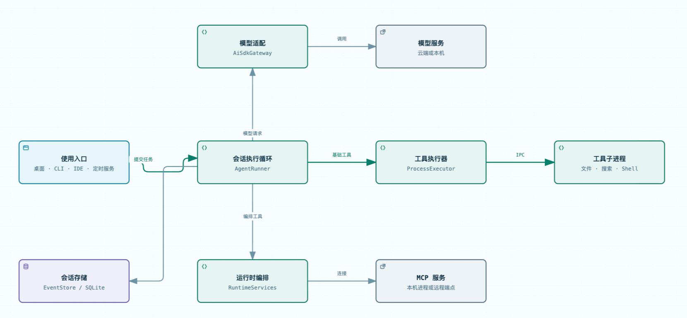
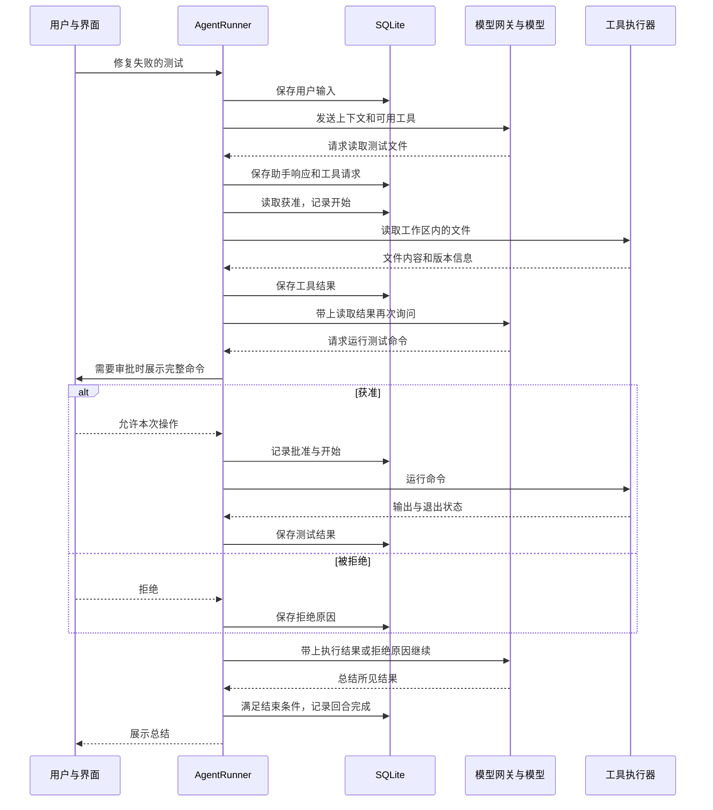

# Bruin 架构图解

假设你打开一个项目，对 Bruin 说：“修复这个失败的测试，然后告诉我改了什么。”谁读测试文件？谁有权运行命令？如果改完文件后应用突然退出，下次打开时又怎么知道做到了哪一步？这三个问题串起了 Bruin 的架构。

**Bruin 在本机组织工作。** 模型根据收到的上下文提出下一步，`AgentRunner` 在本机检查请求、安排工具执行，并把结果写回会话。选用云模型时，提示词以及纳入上下文的代码、附件和工具结果会发送给配置的服务。选择本机兼容端点时，模型请求也可以留在本机。

本文按 2026-11-19 的工作区源码绘制，包版本为 `0.12.1`，基于提交 `9c5c35a`，包含当时尚未提交的实现。文中的“会话”指绑定工作区、可以再次打开的一段对话；“回合”指 Bruin 处理输入直至结束或暂停的过程。一次回合可以多次询问模型。

## 1. 先看全貌

顺着中间一行读，可以看到一个工具请求如何到达本机文件。向上看，是“下一步做什么”的模型请求；向下看，是会话记录和任务编排。箭头表示谁发起调用，工具结果沿调用路径返回。图中方框表示职责，具体进程归属见下一节。[打开可缩放的交互图](bruin-architecture.html) · [可编辑的图源](bruin-architecture.json)

| 核心部件        | 在“修复测试”时负责什么                                                                                                                      | 实现入口                                                                      |
| --------------- | ------------------------------------------------------------------------------------------------------------------------------------------- | ----------------------------------------------------------------------------- |
| AgentRunner     | 组装每次模型请求，接收工具调用，检查参数、权限与预算，决定是否进入下一次模型调用                                                            | [执行循环](../src/core/agent.ts)                                              |
| ModelGateway    | 把统一的消息和工具定义交给供应商，返回文本、工具调用及可用的用量数据。默认实现通过 AI SDK 支持 OpenAI、Anthropic、Google 和 OpenAI 兼容端点 | [模型网关](../src/providers/gateway.ts)                                       |
| EventStore      | 为每个会话的事件分配顺序号，保存执行经过，并协调谁能操作该会话。当前实现使用本机 SQLite                                                     | [存储接口及 SQLite 实现](../src/storage/event-store.ts)                       |
| ToolExecutor    | 接收已经批准的基础工具请求。默认实现通过进程间通信（IPC）交给 Node 子进程，按请求 ID 收回结果                                               | [执行器](../src/executor/client.ts) · [工具子进程](../src/executor/worker.ts) |
| RuntimeServices | 协调需要会话和工作区状态的操作，例如认领任务、启动子 Agent、管理后台命令、连接 MCP 服务                                                     | [运行时服务](../src/runtime/services.ts)                                      |

## 2. 从哪个入口进来，代码在哪里运行

| 入口     | 请求经过的进程与协议                                                                                           | 这个入口的特点                                                                                                                                                                                                         |
| -------- | -------------------------------------------------------------------------------------------------------------- | ---------------------------------------------------------------------------------------------------------------------------------------------------------------------------------------------------------------------- |
| 桌面     | React 界面 → preload 暴露的接口 → Electron 主进程 → 通过标准输入输出传输的逐行 JSON → Node 后台 `desktop-host` | 界面展示文本、审批和文件差异。主进程管理窗口、系统对话框和加密凭证。后台持有执行循环、SQLite 连接、运行时和调度器。[桌面桥接](../desktop/preload.cjs) · [主进程](../desktop/main.cjs) · [后台](../src/desktop-host.ts) |
| 终端     | `bruin chat` → CLI 进程内的执行循环 → 工具子进程                                                               | 终端处理输入、逐步输出、审批和恢复确认。`--resume` 打开已有会话。[CLI](../src/cli.ts)                                                                                                                                  |
| 编辑器   | IDE → 标准输入输出上的 ACP v1 JSON-RPC → `bruin acp`                                                           | IDE 发起新会话和提示词，接收流式更新并向用户请求本次操作许可。编辑器还可传入会话级 stdio MCP 配置。[ACP 适配器](../src/runtime/acp.ts) · [协议范围](ACP.md)                                                            |
| 定时服务 | `bruin service run` → 启动同一份 `desktop-host`，启用服务模式                                                  | 没有窗口时也能领取到期工作。进程从环境变量取得模型密钥，遇到未预授权的操作直接拒绝。桌面后台和独立服务运行调度器，CLI chat 与 ACP 只处理各自的交互请求。[服务入口](../src/runtime/service.ts) · [调度语义](SERVICE.md) |

因此，从 CLI 打开的会话可以在桌面查看，只需指向同一个 Bruin 数据目录。不同入口共同读写持久记录；同一会话的执行权由数据库里的租约协调。桌面还按会话 ID 和事件序号接收后台状态，避免迟到的旧响应覆盖较新的界面。[会话租约](../src/core/session-leases.ts) · [桌面状态更新](../src/core/event-snapshot.ts)

## 3. 跟一次真实的执行路径

下面以“模型先读失败的测试，再申请运行测试命令”为例。模型选择的文件、命令和调用次数由实际项目决定。图中的执行器包含其工具子进程。

**为什么要分开记录“同意”和“开始”？** 用户批准后，进程可能在命令真正启动前退出。日志把请求、决定、开始和结果分别记为 `tool_requested`、`tool_approved` 或 `tool_denied`、`tool_started`、`tool_finished`。其中 `tool_finished` 也能携带错误，例如测试已运行且退出码非零。这个结果足以让模型继续排查。执行已经开始却收不到可靠结果，才需要走中断恢复流程。[工具调用与记录顺序](../src/core/agent.ts) · [恢复逻辑](../src/core/recovery.ts)

模型的文字可以边生成边显示，供恢复使用的完整响应则另存为 `assistant` 事件。一次响应可能请求多个工具。只有整批调用都被注册为可并行、且没有启用工具 Hook 时，执行循环才最多并发三个调用；混有写入的批次按顺序执行。已启动的工作收尾后，下一次模型请求才能使用这批结果。[工具注册表](../src/core/tools.ts) · [并发行为测试](../src/tests/tool-concurrency.test.ts)

## 4. 模型每次看见什么

| 来源              | 怎样进入这次请求                                                                                                                                                                                                                                                              |
| ----------------- | ----------------------------------------------------------------------------------------------------------------------------------------------------------------------------------------------------------------------------------------------------------------------------- |
| 当前任务与历史    | `buildPrompt` 从本地事件重建消息，包括用户输入、助手回复和工具结果。相同模型配置与协议可保留供应商消息细节；切换模型后可用通用消息继续。[历史重建](../src/core/history.ts)                                                                                                    |
| 项目约定与 Skills | 读取全局及项目根目录的 `AGENTS.md`。启用的技能先以目录出现，模型需要时通过 `load_skill` 读取正文，正文留在会话中。内置技能随应用分发，远程安装的技能默认停用。指令和技能都无权授予工具权限。[指令读取](../src/core/instructions.ts) · [技能注册表](../src/skills/registry.ts) |
| 记忆与偏好        | 工作区笔记按当前问题的相关性选入上下文。全局偏好来自用户明确表达、可保存的原文。新请求优先；从仓库、工具或子 Agent 得到的文字仍作为任务资料处理。[记忆检索](../src/core/memory.ts) · [偏好存储](../src/storage/event-store.ts)                                                |
| 附件与引用        | 本机会话保存附件及其元数据，历史通过引用重新装配适用的文本或图片。桌面可以引用已有消息；ACP 的资源链接只传引用信息。[附件处理](../src/core/attachments.ts) · [ACP 输入](ACP.md)                                                                                               |

对话变长后，Bruin 会为工具定义、协议和输出留出空间，把较早内容分段摘要，同时尽量保留当前请求和近期已结算的工具交互。摘要记录带有覆盖到的事件序号，原始事件仍可查。摘要失败时可用本地片段压缩继续。桌面显示的 token 用量来自已记录的供应商响应，统计的是会话累计用量；一次请求实际占用多少上下文另行估算。[上下文管理](../src/core/history.ts) · [用量统计](../src/core/usage.ts)

## 5. 谁能动文件，谁能连外部服务

工具注册表规定名称、参数格式、执行目标，以及是否可供规划模式或只读子 Agent 使用。执行循环先验证参数，再结合会话模式和权限规则作出允许、询问或拒绝的决定。通过这一关后，执行位置取决于工具的职责。[工具注册表](../src/core/tools.ts) · [权限判定](../src/core/permissions.ts)

| 操作                   | 去哪里做                                                                                                             | 对用户意味着什么                                                                                                                                                                                                      |
| ---------------------- | -------------------------------------------------------------------------------------------------------------------- | --------------------------------------------------------------------------------------------------------------------------------------------------------------------------------------------------------------------- |
| 读文件、列目录、搜索   | 工具子进程检查工作区路径，读取文件或运行搜索。仓库索引按内容哈希缓存文件元数据和符号                                 | 想知道函数在哪，可先查索引，再按行读正文。路径校验会拒绝越界及不允许的符号链接。[索引](../src/core/repository-index.ts) · [文件工具](../src/executor/worker.ts)                                                       |
| 改文件、看差异、回滚   | 整体覆盖已有文件前，Agent 需在本段运行中读取当前版本，执行器写前比对哈希。Bruin 文件工具及桌面保存会记录单文件快照   | 若用户在中途改过文件，覆盖会被拒绝。回滚也检查修改后的哈希；撤销新建文件会删除它。Shell、MCP 和外部编辑产生的改动需另行检查。[快照](../src/core/snapshots.ts) · [差异审核](../src/core/workspace-review.ts)           |
| Shell、后台命令与 Hook | 通过工具执行器进入 Shell 后端，可配置 Docker，也会探测 macOS 沙箱或 Linux 的 bwrap。子进程只继承白名单环境变量       | 默认会询问普通 Shell；可按工作区及完整命令匹配已保存的授权。普通 Shell 获准后，在缺少可用沙箱时可能在宿主机运行。Hook 与可写子 Agent 的 Shell 要求沙箱。[执行器](../src/executor/client.ts) · [平台边界](SECURITY.md) |
| MCP 外部工具           | `RuntimeServices` 通过 `McpManager` 发现并调用服务器工具。stdio 启动本机服务进程，Streamable HTTP 访问远程或本机端点 | 发现和调用均经过审批。本机 MCP 进程有自己的环境与权限。桌面可用系统加密存储保存 OAuth 凭证，CLI 和独立服务从各自配置的环境取凭证。[MCP 连接](../src/runtime/mcp.ts) · [OAuth 与凭证](REPOSITORY_RECOVERY_AUTH.md)     |

## 6. 长任务怎样分工

“回合暂停”“计划还剩两步”“子任务已经交卷”描述的是三件不同的事。看长任务时，先辨认界面正在展示哪一种状态。

| 机制                   | 解决的问题                                                                                                           | 如何判断结果                                                                                                                                                                                                                                       |
| ---------------------- | -------------------------------------------------------------------------------------------------------------------- | -------------------------------------------------------------------------------------------------------------------------------------------------------------------------------------------------------------------------------------------------- |
| 运行预算与输入队列     | 单段默认最多调用模型 24 次，可显式选更高预算。运行中可补充当前任务（`steer`），也可排队等当前工作收尾（`follow-up`） | 达到上限先写报告和 `turn_paused`，续跑从记录继续。队列中每条输入都有 ID，转为用户事件时一并记录已接收。立即补充也能唤醒正在等子 Agent 的父会话。[长任务](LONG_TASKS.md) · [输入队列](../src/core/input-queue.ts)                                   |
| 规划模式               | 先读代码、提出步骤，让用户审核后再修改。修改计划会撤销先前批准                                                       | 计划及逐步进度由事件重建。批准计划后仍按工具权限执行；回合结束时仍可能有未完成的计划步骤。[计划状态](../src/runtime/plan.ts)                                                                                                                       |
| 工作区任务图           | 多个任务有依赖时，先认领依赖已满足的任务。共享工作区的会话可看到同一批任务                                           | SQLite 管理依赖、认领与结算，工作区的 `.tasks/<id>.json` 是供人查看、可从数据库修复的副本。[任务存储](../src/storage/event-store.ts)                                                                                                               |
| 子 Agent 与 Git 工作树 | 父会话把独立问题交给使用同一模型配置的子会话。默认只读；可写模式从父仓库当前提交创建独立工作树                       | 父会话收到子任务的回答或失败原因，可据此汇总。从 `HEAD` 创建的工作树不含父工作区未提交修改。需审核子任务改动并决定是否应用导出的补丁，工作树保留供检查。[子 Agent 执行](../src/runtime/subagent.ts) · [审核与补丁](../src/core/workspace-patch.ts) |
| 后台命令与 Hook        | 耗时命令可凭 ID 查询或取消。Hook 是用户预配的静态命令，可在回合或工具执行前后触发                                    | 后台命令有独立开始与结束记录。未批准的规划阶段不运行 Hook；工具批次开始时固定当批 Hook 配置。中断后需按实际工作区状态判断影响。[运行时服务](../src/runtime/services.ts)                                                                            |
| Cron 调度              | 桌面后台或独立服务每 15 秒在空闲时检查工作，先处理到期 Cron，再尝试认领就绪的工作区任务                              | 派发和开始记录在同一事务中提交。租约消失且满足中断判定条件时，未结算派发进入 `needs_review`，等检查后再放行后续调度。错过多个周期不会逐次补跑。[调度循环](../src/desktop-host.ts) · [Cron 恢复](../src/runtime/cron.ts)                            |

## 7. 写完文件突然退出，下一次打开会怎样

假设磁盘上已经有修改，但进程在保存工具结果前退出。单看文件的当前内容，Bruin 无法证明这次调用执行到了哪里。重开会话时，它先取得租约，再将助手提出的调用与已有的开始、结束记录配对。

| 日志留下的证据                                           | 恢复时的处理                                                                                                                                     |
| -------------------------------------------------------- | ------------------------------------------------------------------------------------------------------------------------------------------------ |
| 模型提出调用，但还没有 `tool_started`                    | 补记 `tool_denied`，说明中断前尚未开始。                                                                                                         |
| 已开始，且当时明确标为安全读取，当前注册表也仍认定为安全 | 补记带错误的 `tool_finished`，说明读取中断、结果缺失。                                                                                           |
| 已开始写文件、运行 Shell 或调用 MCP，结果缺失            | 补记 `tool_unknown`。用户检查工作区、测试结果或外部系统后，可在桌面或交互式 CLI 确认已检查。确认记录覆盖看到的序号，后来出现的未知结果仍需检查。 |
| 已记录子 Agent 的启动，或子会话有可核对的原任务结束证据  | 通过关联的开始序号找回子任务 ID；子租约失效后，可将匹配委派输入的首轮结果补回父会话。证据不足的任务保留为未结算。                                |

恢复过程只补记录。尤其在这个例子中，自动再写一遍可能覆盖用户退出后的修改；因此 Bruin 把“核对已经发生的事”和“继续执行”分成两步。[恢复扫描](../src/core/recovery.ts) · [人工确认](../src/core/unknown-review.ts) · [恢复测试](../src/tests/tool-recovery.test.ts)

**同一会话如何避免两头执行？** SQLite 给当前所有者发放有期限的租约，由心跳续期。一个进程里的前台回合和后台工作可以共用所有者，最后一项工作收尾才释放；子 Agent 同时持有父、子会话的租约。续期失败会向持有者发送取消信号。已经发生的文件修改或远程操作仍需按日志核实。[会话租约](../src/core/session-leases.ts) · [租约测试](../src/tests/session-leases.test.ts)

**界面如何知道该显示“继续”？** `turnState` 从后往前寻找决定主回合状态的事件。`turn_paused` 表示暂停，`turn_completed` 表示结束，较新的用户输入、助手响应、模型错误或未知工具结果表示有未结算工作。晚到的后台结果、Hook 记录和配置变更不会遮住先前的暂停或结束状态。[回合状态](../src/core/turn-state.ts) · [状态测试](../src/tests/turn-state.test.ts)

## 8. 数据在哪里，出了问题从哪里查

默认数据目录是 `~/.bruin/`，可用 `BRUIN_HOME` 指定。工作区是用户选定的项目目录，也可以是 Bruin 管理的项目。数据目录保存“Bruin 做过什么”，工作区保存“项目现在是什么样子”；排查一次有副作用的操作通常要看两处。

| 位置                                                                    | 保存什么                                                                                                | 典型用途                                                                                                                                             |
| ----------------------------------------------------------------------- | ------------------------------------------------------------------------------------------------------- | ---------------------------------------------------------------------------------------------------------------------------------------------------- |
| `BRUIN_HOME/sessions.sqlite`                                            | 会话和模型配置快照、按会话序号排列的事件、租约、工作区任务、Cron、工作区记忆、用户偏好                  | 查看一次审批或工具结果，重建主回合与计划状态。当前 schema 为 8；事件追加与会话更新时间在同一事务中提交。[SQLite 实现](../src/storage/event-store.ts) |
| `BRUIN_HOME/config.json`、`keys.enc.json`、`oauth.enc.json`             | 配置文件保存模型配置、授权规则、MCP 与 Hook 设置；后两个文件由桌面主进程保存加密的模型密钥和 OAuth 凭证 | 在桌面可用的模型或登录状态，换到服务模式时需核对进程环境与凭证来源。[配置](../src/config.ts) · [桌面凭证](../desktop/main.cjs)                       |
| `BRUIN_HOME/attachments/`、`snapshots/`、`repository-index/`、`skills/` | 会话附件、单文件快照、可重建的索引缓存、已安装技能                                                      | 查找旧附件、审核一次文件恢复、区分用户资料与缓存。[文件快照说明](REPOSITORY_RECOVERY_AUTH.md) · [附件实现](../src/core/attachments.ts)               |
| 项目目录、`BRUIN_HOME/workspaces/`、`BRUIN_HOME/worktrees/`             | 用户项目、Bruin 托管项目、独立 Git 工作树及各自未提交的修改                                             | 找实际改动时，先确认当前会话绑定哪个目录；查看子任务时，还要核对它的工作树和基线提交。[工作区运行时](../src/runtime/services.ts)                     |

离线备份使用 SQLite 的一致性副本，附带配置与相关数据文件的校验清单。外部项目和 Git 工作树要单独保存；应用数据备份不能替代项目备份。诊断本机依赖可用 `bruin doctor`，核对当前入口暴露了哪些工具可用 `bruin capabilities`。[备份与诊断](OPERATIONS.md) · [备份实现](../src/storage/backup.ts)

## 9. 按问题读源码

| 想弄清的问题                                   | 从这里开始                                                                                                  | 用什么核对                                                                                                       |
| ---------------------------------------------- | ----------------------------------------------------------------------------------------------------------- | ---------------------------------------------------------------------------------------------------------------- |
| 已批准的调用为什么没有执行，或者为什么停下来？ | [执行循环](../src/core/agent.ts)、[权限判定](../src/core/permissions.ts)                                    | [运行控制测试](../src/tests/agent-control.test.ts)                                                               |
| 切换模型后如何带上历史？                       | [模型网关](../src/providers/gateway.ts)、[历史重建](../src/core/history.ts)                                 | [供应商协议测试](../src/tests/provider.test.ts)、[历史测试](../src/tests/history.test.ts)                        |
| 模型已经回答，为什么父会话还在等？             | [运行时服务](../src/runtime/services.ts)、[子任务结果](../src/core/subagent-results.ts)                     | [结果交付测试](../src/tests/subagent-delivery.test.ts)、[子任务恢复测试](../src/tests/subagent-recovery.test.ts) |
| 定时任务为什么要求检查？                       | [桌面后台的调度与结算](../src/desktop-host.ts)、[Cron 恢复](../src/runtime/cron.ts)                         | [服务调度测试](../src/tests/cron-service.test.ts)                                                                |
| 从桌面点到代码改动，中间经过哪些进程？         | [界面](../desktop/renderer/src/main.tsx)、[桌面主进程](../desktop/main.cjs)、[后台](../src/desktop-host.ts) | [桌面协作集成测试](../src/tests/desktop-collaboration.test.ts)                                                   |

维护者需要修改模型、存储或执行器时，可以继续查阅现有接口必须保持的事务和恢复语义。[架构与扩展契约](ARCHITECTURE.md)
