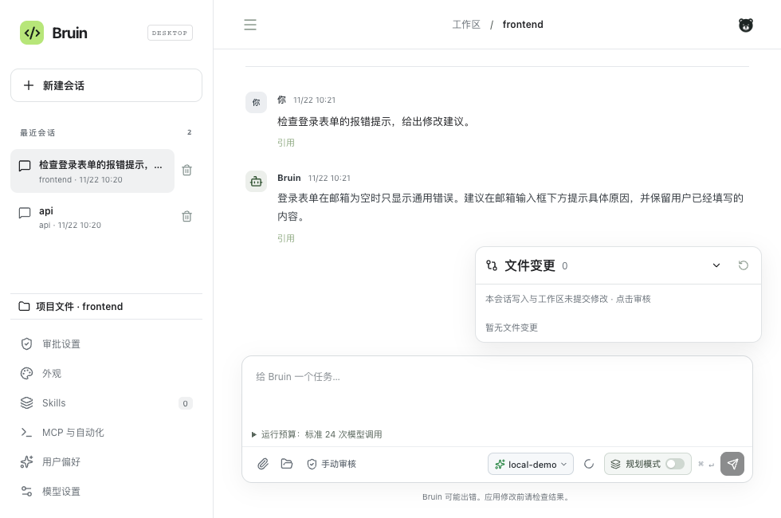
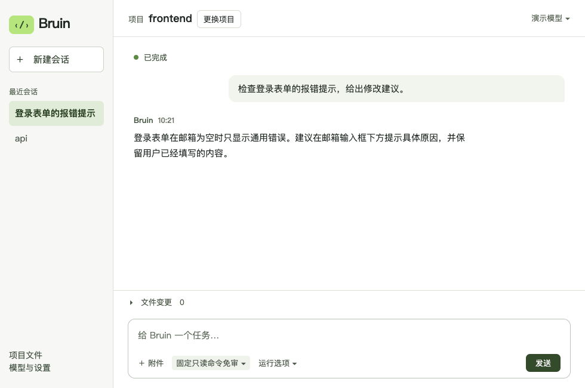

# Bruin 桌面客户端交互与视觉改进清单

2026-11-22 · 基于 `dev` 的 `905dfae` 及检查时已有的工作区改动。范围是用户直接操作的 Electron 桌面窗口。

**建议首批修复三件事：关标签会丢掉未保存的文件编辑，切换项目会带走上一会话的消息草稿，运行中可以新建会话并在新项目界面看到旧项目的审批。** 三项都可以沿用现有的会话、保存和审批机制。随后改主窗口布局，让用户随时看得见当前项目、任务状态和下一步操作。

## 主窗口应该怎样显示

同为 **980 × 650** 的桌面窗口渲染视口，下图使用相同的项目、消息、审批模式和零文件变更场景。左侧是实际 React 界面，右侧是用来讨论布局的静态设计稿。点击图片可查看原尺寸。

| 当前界面                                                                                                                  | 建议布局                                                                                                                              |
| ------------------------------------------------------------------------------------------------------------------------- | ------------------------------------------------------------------------------------------------------------------------------------- |
|  |  |

- **顶部回答“我在哪个项目”。** 保留项目名、可点击的更换入口和当前模型。长路径按需展开并可复制。窄窗口压缩路径和侧栏，保留“更换项目”的动作。
- **消息区回答“执行到了哪一步”。** 正文优先于项目介绍、会话 ID 和用量。历史详情放在可展开区域。运行中展示最近一次有证据的动作，收到审批后显示“等待你审批”，暂停时显示原因和“继续任务”。颜色配合文字，避免仅靠绿点或转圈表达状态。
- **文件区回答“我需要查看哪些修改”。** 零变更收成一行。有变更时显示数量，沿用已有的来源、增删改标签和文件详情。窄窗口在正文下方展开，宽窗口可放在独立侧栏，用户阅读和选择的正文不应被面板盖住。
- **输入区回答“发出去会发生什么”。** 保留附件、实际审批模式和发送，预算与规划收进“运行选项”。运行中直接用“补充当前任务”或“排到下一项”标示投递意图。截图只展示已完成状态，现有的停止、恢复、引用和设置入口都应在对应状态可达。

## 第一批 · 保护用户正在做的工作

### 01 · P0 · 关闭文件前处理未保存的编辑

**实施进展。** 关闭标签、新建或切换会话、更换工作区、删除当前会话和关闭窗口会共用未保存文件确认。取消保留标签及编辑，保存成功后才继续。保存时仍校验磁盘原内容，发生冲突时保留编辑器内容。

**已在界面复现。** 打开项目文件，改一行，出现“未保存”后关闭标签，再打开只剩原内容。关闭按钮直接从 `openFiles` 移除文件，切换会话和成功更换工作区也会清空列表。现有磁盘写入冲突校验保护的是已经发起的保存，尚在编辑器里的文字需要单独保护。[标签与会话切换](../desktop/renderer/src/main.tsx) · [编辑器的未保存判断](../desktop/renderer/src/files/FileEditorViewer.tsx)

**改法与验收。** 复用 `content !== originalContent` 和 `saveFile`。在关闭标签、会话切换、新建、换工作区及关窗前统一处理脏文件，提供“保存并继续 / 放弃修改 / 取消”。两份文件有改动时列出文件名。逐一走这些入口，验证取消后原文仍在、保存成功才离开、遇到外部改写或保存失败时保留编辑且可复制。干净文件应直接关闭。

### 02 · P1 · 消息草稿跟随会话与项目

**实施进展。** 草稿在当前窗口内按会话 ID 和工作区路径保存，切回时一起恢复文字、附件和引用。发送成功只清除提交所在工作区的草稿。

**已在界面复现。** 在 frontend 的输入框写一句话，不发送，点击 api 会话，原文仍在 api 输入框。此时点发送，客户端会携带当前会话 ID。切换时附件和引用则被清空，一份由文字、附件、引用组成的草稿会被拆开。[输入状态、showSession 与 send](../desktop/renderer/src/main.tsx)

**改法与验收。** 首版可在窗口内按会话 ID 和工作区保存整份草稿，切回时恢复。A、B 分别编辑不同草稿，A 带附件和引用；来回切换后分别发送，检查目标会话和内容均匹配。切换工作区后也应隔离旧草稿。先覆盖窗口内切换，跨重启持久化另行决定。

### 03 · P1 · 运行中的审批必须能辨认所属项目

**实施进展。** 活动运行期间禁用新建会话，并在后台拒绝同时到达的新建请求。审批卡显示发起操作的工作区和会话标识，停止操作也指向该会话。[后台回归](../src/tests/desktop-host.test.ts)

**已在界面复现。** 模拟 A 开始运行后点“新建会话”，界面切到 B，“停止运行”消失。再送达 A 的审批，B 页面出现审批卡，只列工具、参数、原因和授权范围，没有 A 的项目标识。后台仍按原审批 ID 处理。用户可能在看着 B 时为 A 的操作作决定。[新建、事件订阅及审批卡](../desktop/renderer/src/main.tsx) · [后台对活动会话和审批归属的处理](../src/desktop-host.ts)

**改法与验收。** 首版沿用后台单活动会话的语义，运行中禁用切走的新建入口并说明原因。审批卡直接显示来源项目、工作路径和授权范围；拒绝、允许和停止始终对应来源会话。覆盖运行中点击新建、延迟到达的审批、取消和任务结束四种时序，验证没有无来源的审批卡，结束后可以正常新建。

## 第二批 · 改善主窗口和文件审核

| 编号                           | 用户遇到的情况与证据                                                                                                                                                                                                                                                                                                                                 | 建议改动与验收                                                                                                                                                                                   |
| ------------------------------ | ---------------------------------------------------------------------------------------------------------------------------------------------------------------------------------------------------------------------------------------------------------------------------------------------------------------------------------------------------- | ------------------------------------------------------------------------------------------------------------------------------------------------------------------------------------------------ |
| **04 · P1** 选项目             | 新建按钮直接传空工作区，已有的项目选择对话框没有接入这两个新建按钮。现有会话只能通过顶部路径更换项目。实测该按钮在 1280 像素宽时可见，在 1100 和 980 时宽度为零。按快速开始指南操作的小窗口用户无法从这条路径选已有仓库。[新建与换目录](../desktop/renderer/src/main.tsx) · [窗口断点](../desktop/renderer/src/style.css) · [快速开始](../README.md) | 复用 `NewSessionDialog` 与系统目录选择器，保留“使用默认工作区”快捷路径。窄窗在项目名旁保留更换按钮。三个宽度分别验证新建空工作区、新建已有项目、取消选择和更换项目；第一条任务发出前能确认目录。 |
| **05 · P1** 看清审批模式       | 模拟配置为“固定只读命令免审”时，设置能表示三种模式，输入区徽标却显示“手动审核”。这个按钮从只读免审点击一次就请求切到自动模式，设置写入全局配置。[模式按钮与设置选择器](../desktop/renderer/src/main.tsx) · [setApprovalMode](../src/desktop-host.ts)                                                                                                 | 两处共用三种模式的名称和说明。点击徽标展开选择，在选项中写明影响其他会话。分别载入三种配置，核对徽标、菜单选中项和设置页一致；只打开或取消菜单不应更改策略。                                     |
| **06 · P2** 把空间还给对话     | 在 980 × 650 的模拟会话中，对话区为 712 × 384 像素，零变更面板仍以 360 × 121 像素的浮层显示，正文为展开态预留 285 像素底部空间。见上方实测截图。[变更面板](../desktop/renderer/src/main.tsx) · [conversation-frame 与 workspace-review-dock](../desktop/renderer/src/style.css)                                                                      | 按上图先实现零变更折叠，再处理有变更时的布局。用 0、1、20 个变更文件和一段长回复，在最小窗口逐屏阅读、选字、展开文件。正文、发送、停止都应可见或可滚动到，面板不能盖住正在读的文字。             |
| **07 · P1** 大文件差异计数失真 | 直接调用渲染器的 `computeLineDiff`：构造 1,300 行唯一文本，仅替换首尾两行，结果为 **+1,300 / −1,300**。共同前后缀被剥离后，中段行数乘积超阈值会整段按删除和新增展示，标签和编辑器都把计数当成普通差异。[差异算法](../desktop/renderer/src/files/line-diff.ts) · [差异展示](../desktop/renderer/src/files/FileEditorViewer.tsx)                       | 首先给粗略结果加“简化对比”标识，隐藏容易让人误判的精确计数；若改进算法，用同一夹具验收为 +2 / −2。另测整文件替换、新建、删除、无变化，标签和正文须给出一致结论。                                 |

## 第三批 · 让任务状态和键盘操作可用

| 编号                 | 当前表现                                                                                                                                                                                                                                                             | 改进与验收                                                                                                                                                                                                                                                             |
| -------------------- | -------------------------------------------------------------------------------------------------------------------------------------------------------------------------------------------------------------------------------------------------------------------- | ---------------------------------------------------------------------------------------------------------------------------------------------------------------------------------------------------------------------------------------------------------------------- |
| **08 · P2** 任务状态 | 运行中无流式文本时显示“Bruin 正在处理…”。工具组默认显示调用次数，只有展开才见结果；审批、暂停、未知结果与继续按钮分布在页面不同位置。[会话渲染](../desktop/renderer/src/main.tsx) · [工具组](../desktop/renderer/src/conversation/Messages.tsx)                      | 在消息区顶部保留一个当前状态。按现有事件显示“等待模型回复”“等待你审批”“已暂停”“需要检查结果”或“已完成”。工具摘要展示最近可识别的工具和结果，有错误时提供展开入口。回放成功、拒绝、暂停、待复核四条轨迹；阅读历史消息时仍能找到对应操作，历史错误不能永久覆盖当前状态。 |
| **09 · P2** 键盘导航 | 源码检查发现公共设置弹窗使用普通容器，关闭图标没有可访问名称，也没有处理 Esc、焦点限制与焦点归还。文件编辑器还会拦截 Shift+Tab，且该分支不执行动作。[Modal](../desktop/renderer/src/main.tsx) · [编辑器按键处理](../desktop/renderer/src/files/FileEditorViewer.tsx) | 弹窗提供可读名称、初始焦点、焦点循环与 Esc 关闭，关闭后焦点回到触发按钮。编辑器提供可发现的键盘离开方式。用纯键盘完成“打开模型设置 → 编辑 → 退出 → 回到对话”，再走一次文件编辑与保存；深浅主题均能看见焦点。                                                           |

## 实施与回归

1. **先做 01–03。** 用两个模拟项目、两份文件、一条延迟审批建立可重复的界面用例。断言草稿内容、文件内容和审批归属，避免仅凭截图判定交互正确。
2. **然后做 04–07。** 项目入口与窗口布局可一起提交；差异展示可独立修复。每次保留 980 × 650、1100 × 800、1280 × 800 三档截图，覆盖长中文路径、长回复、深浅主题。
3. **最后做 08–09。** 状态文案以后台已发出的事件为依据。逐项勾选时记录测试场景、截图或断言，以及使用的系统和窗口尺寸。

**本次验证。** 在采集界面样例的工作区版本上，核心与桌面 TypeScript 检查、核心构建均通过。检查期间工作区另有并行开发，本清单以实测界面为基线。使用 macOS 上的无头 Chrome 加载当前 React 渲染器、样式和图标，以模拟 IPC、虚构项目及消息完成界面操作和尺寸测量；另直接运行了差异算法样例。设计稿展示建议效果。原生目录选择器、关窗拦截、真实模型、读屏器、Windows 和 Linux 的最终表现仍需在实施时验收。

**01–02 回归。** macOS Electron 使用 `frontend` 和 `backend` 两个临时项目，运行打包后的界面、桌面 IPC、文件读写和 SQLite 会话。验证了取消关闭和导航时保留编辑、保存后关闭、磁盘冲突时保留编辑、关窗，以及切回原会话和项目时恢复草稿。两份草稿实际发送后，分别核对了会话中的文字、附件和引用。测试注入了文件与目录选择结果，并使用本地固定模型响应。复跑前执行 `npm run desktop:build`，再运行 `npx electron test/desktop/interaction.cjs`。[回归用例](../test/desktop/interaction.cjs)
