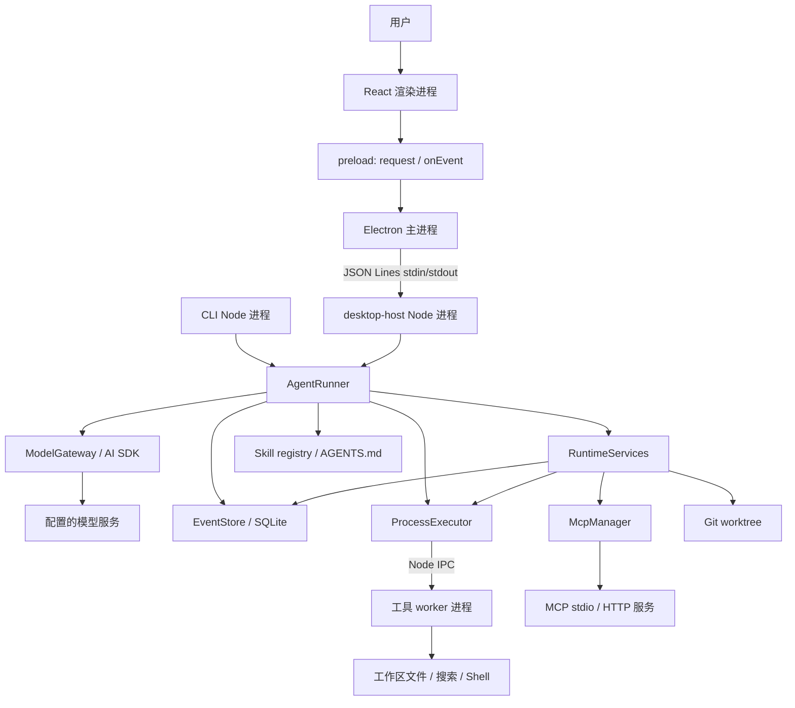
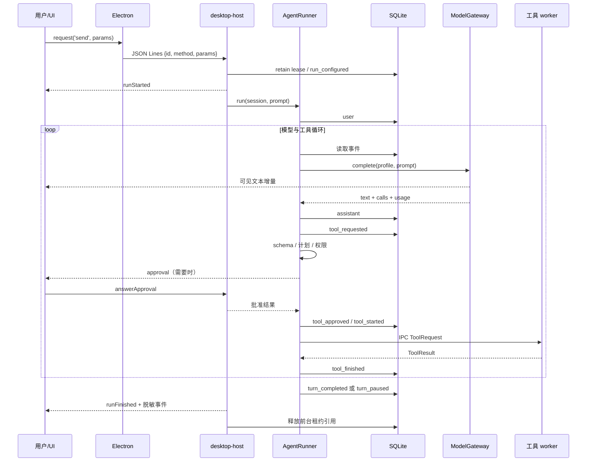

# Bruin 项目完整学习文档：架构、源码与运行机制

> 分析日期：2026-10-08（北京时间）。版本：`bruin-agent 0.12.0`。源码基准：`9aaca39d4ff3b92ef40e8b0207fbfb158826ab47`。
>
> 本文以当前仓库源码为主要依据，结合既有文档与测试。示意代码均会注明；设计建议不代表已实现功能。源码链接使用仓库相对路径，方便在 GitHub 或本地 Markdown 编辑器中阅读。行号对应上述提交，后续修改可能改变位置。

## 阅读导航

- [1. 项目定位与核心概念](#1-项目定位与核心概念)
- [2. 技术栈、目录与构建](#2-技术栈目录与构建)
- [3. 总体架构与进程边界](#3-总体架构与进程边界)
- [4. 一次请求的完整执行过程](#4-一次请求的完整执行过程)
- [5. 核心类型与接口](#5-核心类型与接口)
- [6. AgentRunner 源码详解](#6-agentrunner-源码详解)
- [7. 提示词、历史重建与上下文压缩](#7-提示词历史重建与上下文压缩)
- [8. Provider 适配与流式协议](#8-provider-适配与流式协议)
- [9. 工具目录与分派机制](#9-工具目录与分派机制)
- [10. 权限与审批](#10-权限与审批)
- [11. 执行进程、文件操作与 Shell 沙箱](#11-执行进程文件操作与-shell-沙箱)
- [12. SQLite、事件与迁移](#12-sqlite事件与迁移)
- [13. 会话租约、并发与崩溃恢复](#13-会话租约并发与崩溃恢复)
- [14. 计划、任务图与自动调度](#14-计划任务图与自动调度)
- [15. 运行时服务：Hook、后台任务、子 Agent 与工作树](#15-运行时服务hook后台任务子-agent-与工作树)
- [16. MCP 与 OAuth](#16-mcp-与-oauth)
- [17. Skills、指令与记忆](#17-skills指令与记忆)
- [18. 仓库索引、文件快照与差异审核](#18-仓库索引文件快照与差异审核)
- [19. 附件、引用与用量统计](#19-附件引用与用量统计)
- [20. 桌面端源码与通信协议](#20-桌面端源码与通信协议)
- [21. CLI、配置与运行环境](#21-cli配置与运行环境)
- [22. 测试、构建发布与本次验证](#22-测试构建发布与本次验证)
- [23. 当前边界与源码阅读注意事项](#23-当前边界与源码阅读注意事项)
- [24. 学习路线、实验与扩展方法](#24-学习路线实验与扩展方法)
- [25. 全量源码职责索引](#25-全量源码职责索引)
- [26. 术语表与既有文档](#26-术语表与既有文档)

## 1. 项目定位与核心概念

### 1.1 Bruin 实际解决什么问题

Bruin 是运行在本机的编码 Agent。用户描述目标，Bruin 向模型提供对话与工具说明，模型返回回答或工具调用；程序验证并审批这些调用，在工作区执行，将结果反馈给模型，直到模型结束回答或达到预算。

它包含两个用户入口：Electron + React 桌面客户端，以及 Node.js CLI。二者复用核心 Agent、SQLite 数据库、模型适配和工具执行逻辑。项目没有独立云端业务服务、账号系统或 PostgreSQL 后端。

“本地运行”指编排、文件操作和数据存储在本机；配置云 Provider 时，模型输入仍通过网络发送到所配置的服务。使用本地 OpenAI 兼容服务时，模型也可以运行在本机。

从功能角度可以分成五组：

| 能力       | 具体内容                                         | 学习重点                         |
| ---------- | ------------------------------------------------ | -------------------------------- |
| 对话与模型 | 多 Provider、流式回答、模型切换、历史压缩        | 模型协议与应用控制循环的分工     |
| 编码工具   | 读写文件、精确替换、目录浏览、搜索、Shell        | schema、权限、进程隔离与文件安全 |
| 可恢复运行 | 事件日志、租约、未知结果、暂停续跑               | 状态持久化与外部副作用之间的边界 |
| 长任务编排 | 计划、任务依赖、后台命令、Cron、子 Agent、工作树 | 状态机、并发所有权与调度         |
| 扩展与桌面 | Skills、MCP、OAuth、附件、差异审核、加密密钥     | 扩展内容的信任边界与桌面 IPC     |

### 1.2 必须先区分的概念

| 概念            | Bruin 中的含义                                                    |
| --------------- | ----------------------------------------------------------------- |
| Session（会话） | 绑定工作区和模型配置的持久对话容器，有 UUID                       |
| Turn（回合）    | 一次用户请求及其后续模型和工具活动；可跨暂停续跑                  |
| Run（运行段）   | 一次 `AgentRunner.run()` 调用，有模型调用预算                     |
| Model call      | 一次主循环中的 `gateway.complete()`；失败重试和摘要请求需另行理解 |
| Tool call       | 模型返回的具体工具请求，包含 ID、名称和输入                       |
| Plan            | 会话内的线性执行步骤与审批状态                                    |
| Task            | 工作区共享的持久任务节点，包含依赖、状态和所有者                  |
| Lease（租约）   | 有有效期的执行所有权；会话租约和任务租约是两套机制                |
| Skill           | 按需读取的 Markdown 工作流程及附属文件，不会自动增加工具权限      |
| MCP             | 与外部工具服务器通信的协议接入，不等同于 Skill                    |
| Snapshot        | 一次文件修改前的字节内容和修改后的 hash，用于受约束回滚           |

一个回合可以调用模型多次，每次响应可以带多个工具。同一批工具在 `AgentRunner` 中依次执行，不能因为模型返回数组就认为它们并发执行。

### 1.3 三条理解主线

第一条是控制流：用户 → 模型 → 权限 → 工具 → 结果 → 模型。第二条是数据流：事件 → 提示词重建 → 模型响应 → 新事件。第三条是所有权：前台、后台与子 Agent 如何取得和保持租约，以及失去所有权后如何停止。

学习时先沿这三条主线读源码，再看桌面交互与扩展功能，能避免被较大的 UI 文件和运行时分支淹没。

## 2. 技术栈、目录与构建

### 2.1 技术栈

依据：[package.json](../package.json)、[核心 tsconfig](../tsconfig.json)、[桌面 tsconfig](../desktop/tsconfig.json)。下表是声明范围；精确安装版本由 `package-lock.json` 锁定，不能把 `^` 范围直接当成当前安装版本。

| 分类         | 依赖/配置                             | 使用位置                   |
| ------------ | ------------------------------------- | -------------------------- |
| 语言与运行时 | TypeScript、Node.js ≥ 22.12、ESM      | `src/`，编译至 `dist/`     |
| 模型 SDK     | `ai ^6.0.0` 与四类 Provider adapter   | `providers/gateway.ts`     |
| 输入校验     | `zod ^4.0.0`                          | 配置、工具、附件元数据     |
| 持久化       | `better-sqlite3 ^12.0.0`              | 同步 SQLite 存储实现       |
| MCP          | `@modelcontextprotocol/client 2.1.0`  | stdio、HTTP、OAuth         |
| 定时表达式   | `cron-parser ^5.10.1`                 | 持久 Cron 作业             |
| Skill 元数据 | `yaml ^2.9.1`                         | `SKILL.md` front matter    |
| 桌面容器     | `electron ^41.10.7`                   | 窗口、系统对话框、安全存储 |
| UI           | `react/react-dom ^19.3.0`             | 桌面渲染进程               |
| Markdown     | `react-markdown`、`remark-gfm`        | 消息和表格渲染             |
| 前端构建     | `vite ^8.3.1`                         | React 静态资源与开发服务器 |
| 测试         | Node.js 内置 `node:test` 与 `assert`  | `src/tests/`               |
| 分发         | `electron-builder`、`@resvg/resvg-js` | 打包、图标生成             |

核心使用 `target: ES2022`、`module/moduleResolution: NodeNext` 和严格类型检查。源码中的 `.js` import 是为编译后的 Node ESM 服务，虽然实际源文件是 `.ts`。

桌面前端使用 `ESNext`、`Bundler` 模块解析、`react-jsx` 与 DOM 类型。Electron 主进程、preload 和脚本采用 `.cjs`，即显式 CommonJS；这是同一仓库里两种运行环境的正常分工。

### 2.2 目录结构

```text
Bruin/
├── package.json / package-lock.json   命令、依赖及锁文件
├── tsconfig.json                     核心 TypeScript 编译配置
├── src/
│   ├── cli.ts                        CLI 入口
│   ├── desktop-host.ts               桌面 Node 后台与 JSON Lines RPC
│   ├── config.ts                     配置、运行时密钥与文件锁
│   ├── core/                         Agent、历史、权限、文件及恢复机制
│   ├── providers/                    模型适配和模型目录
│   ├── executor/                     工具 IPC 客户端及 worker
│   ├── storage/                      SQLite EventStore
│   ├── runtime/                      编排、计划、MCP、OAuth
│   ├── skills/                       Skill 安装、索引与市场
│   └── tests/                        21 个测试文件
├── desktop/
│   ├── main.cjs / preload.cjs         Electron 主进程与桥接
│   ├── renderer/src/main.tsx          React UI 主文件
│   ├── renderer/src/style.css         桌面样式与主题
│   ├── renderer/index.html            HTML、CSP、前端入口
│   ├── scripts/                      开发、图标、运行时和发布素材脚本
│   ├── assets/                       熊图标源及素材
│   ├── vite.config.ts                Vite 配置
│   └── electron-builder.yml          平台分发配置
├── skills/builtin/                   plan/debug/code-review/test
├── docs/                             架构、介绍、审查及历史文档
├── .github/workflows/                跨平台校验和发布流水线
└── dist/、.desktop-runtime/等         编译、打包与缓存产物
```

`test/` 顶层目录目前不是测试实现所在位置；实际测试在 `src/tests/`，随核心一起编译后由 `dist/tests/*.test.js` 执行。阅读时应以 `src/` 为准，避免把编译输出视为另一个源码系统。

### 2.3 构建链

```text
src/**/*.ts --tsc--> dist/**/*.js + .d.ts
React/Vite --------> desktop/build/renderer/
icon.svg --Resvg---> 五种配色 icon-*.png
dist + skills + Node 二进制 + 生产依赖 --> .desktop-runtime/
Electron 文件 + renderer + runtime --> 平台安装包
```

`npm run desktop:dev` 先构建核心，再通过 `dev.cjs` 启动 Vite 和 Electron。Vite 前端有开发服务器；核心没有在这个脚本中启动 TypeScript watch，因此修改核心后要重新构建并重启相关进程。

## 3. 总体架构与进程边界

### 3.1 系统图



不支持 Mermaid 的阅读器可以直接参照本节下表；图只是当前源码调用关系的示意。

### 3.2 桌面的四个主要进程

| 进程            | 入口                      | 主要职责                                  | 不应混淆的边界                         |
| --------------- | ------------------------- | ----------------------------------------- | -------------------------------------- |
| React 渲染进程  | `main.tsx`                | 展示会话、编辑器、审批和设置              | 没有直接 Node 文件或数据库访问         |
| Electron 主进程 | `main.cjs`                | 窗口、系统文件选择、safeStorage、后台通信 | 不执行 Agent 主循环                    |
| Node 核心后台   | `dist/desktop-host.js`    | 模型、权限、事件、运行时编排              | 掌握模型密钥，调度部分外部能力         |
| Node worker     | `dist/executor/worker.js` | 文件工具、搜索、Shell                     | 不继承模型密钥，但不是完整 OS 权限隔离 |

CLI 省去前两层，由 `cli.ts` 直接构造 Agent 和服务。MCP stdio、Shell、后台命令可能再创建其他进程；子 Agent 是核心后台中的另一个 `AgentRunner` 与独立会话，不是每个子 Agent 单独 fork 一个 OS 进程。

### 3.3 可替换的三个接口

`AgentRunner` 的构造函数依赖 `EventStore`、`ModelGateway`、`ToolExecutor` 和 `AgentIO`，而非直接创建 HTTP 请求或 SQLite 连接。这使测试能注入模拟模型、模拟执行器和内存式交互。

| 接口           | 作用                               | 当前实现               |
| -------------- | ---------------------------------- | ---------------------- |
| `ModelGateway` | 完成一次模型交互、可选摘要         | `AiSdkGateway`         |
| `ToolExecutor` | 执行低层工具、关闭资源             | `ProcessExecutor`      |
| `EventStore`   | 会话、事件、租约、任务、Cron、记忆 | `SqliteEventStore`     |
| `AgentIO`      | 输出文本、通知、审批和检查点       | CLI 回调或桌面事件回调 |

这是便于替换的接口边界，但核心仍依赖具体的 Skill registry、配置函数及运行时服务类型。它没有做到“任何模块都完全与 Node 和文件系统无关”。

## 4. 一次请求的完整执行过程

### 4.1 桌面请求时序



这里展示文件工具路径；MCP、任务、记忆等会转入 `RuntimeServices`。拒绝时记录 `tool_denied`，不进入执行器。执行结果不能确认时记录 `tool_unknown` 并停止当前运行。

### 4.2 用“修复一个函数”串起来理解

假设用户让 Bruin 修复 `src/math.ts` 中的错误：

1. 用户消息先成为 `user` 事件。
2. 系统提示词加入工作区、指令、Skill 索引、任务和记忆；历史事件重建成模型消息。
3. 模型提出 `read_file`，程序验证输入与路径，默认允许工作区内普通文件读取。
4. 读取结果成为 `tool_finished`，下一次模型调用能看到源码。
5. 模型提出 `edit_file`，程序要求批准；拒绝会作为错误结果反馈给模型。
6. 批准后 worker 验证 `oldText` 恰好出现一次，保存快照并原子替换文件。
7. 模型可提出 `shell` 执行测试，仍经过相应审批与沙箱选择。
8. 模型无工具调用时，程序写 `turn_completed`；这只是回合结束，测试是否成功仍要看工具结果和实际文件。

在这个流程中，模型负责选择下一步，程序负责决定工具是否可执行、如何执行和怎样记账。

### 4.3 持久事件与即时界面是两条不同路径

`text` 增量直接用于 UI 流式显示；完整模型响应结束后才存为 `assistant`。因此，看到一段流式文字不代表它已经完整写入数据库。发生流中断时，已展示的部分文字可能只存在于当前 UI。

`send` RPC 返回 `{started: true}` 也只意味着运行已启动，结果由之后的 `runFinished` 或 `runFailed` 事件通知。`runFinished` 包含正常暂停的情况，不能直接等同于用户目标完成。

## 5. 核心类型与接口

依据：[types.ts](../src/core/types.ts)、[gateway.ts](../src/providers/gateway.ts#L10)、[event-store.ts](../src/storage/event-store.ts#L47)。

### 5.1 Session 与 ModelProfile

`ModelProfile` 包含 `alias`、`provider`、`model`、可选 `baseUrl`、`apiKeyEnv` 和 `contextWindowTokens`。`apiKeyEnv` 保存环境变量名称，不应保存密钥值。

`Session` 保存工作区路径、模型配置快照、创建更新时间和 `managedWorkspace`。会话里保存的是完整 profile，因此“改默认模型”和“改会话使用模型”并非同一操作；桌面保存同别名配置时还会显式同步已有会话。

### 5.2 ToolCall、ToolRequest、ToolResult

| 类型           | 关键字段                                                                 | 意义                       |
| -------------- | ------------------------------------------------------------------------ | -------------------------- |
| `ToolCall`     | `id/name/input`                                                          | 模型层面的调用             |
| `ToolRequest`  | `requestId/name/input/workspace/timeoutMs/maxOutputBytes/requireSandbox` | 低层执行请求               |
| `ToolResponse` | `requestId/result`                                                       | IPC 响应                   |
| `ToolResult`   | `output/isError/exitCode/truncated`                                      | 有确定结果的工具执行返回值 |

模型 `call.id` 与 IPC `requestId` 一般不同。Agent 生成新的 UUID 关联执行器请求，持久事件则继续使用模型 `callId`。不要把会话事件序号 `seq`、模型工具 ID 和进程请求 ID 混为一谈。

TypeScript 的 `ToolName` 联合类型只提供编译期约束；模型、IPC 和 JSON 的输入必须在运行时验证。源码因此同时使用 schema 校验、白名单和 worker 再检查。

### 5.3 EventStore 的范围

虽然名为 `EventStore`，它不仅存事件，还负责会话资料、租约、工作区任务、Cron、工作区记忆和用户偏好。理解为“核心持久化端口”更贴近当前实现。

`AgentIO.approve()` 可返回 `true`、`false` 或一段拒绝原因。字符串会被作为 `tool_denied.output` 传回模型，无人值守模式正是利用这个分支说明需要授权。

## 6. AgentRunner 源码详解

入口：[AgentRunner](../src/core/agent.ts#L268)、[recover](../src/core/agent.ts#L278)、[run](../src/core/agent.ts#L307)。

### 6.1 主循环的等价伪代码

以下是帮助理解的伪代码，并非可以直接替换项目实现的代码：

```ts
validateRunBudget();
if (hasNewInput) persistUserAndExplicitPreferences();
if (allowedByPlan && hasNewInput) runTurnStartedHooks();

for (let step = 0; step < maxSteps; step++) {
  checkCancellationAndDeadline();
  const events = store.events(session.id);
  const system = assembleCurrentInstructionsAndState(events);
  const prompt = compactAndBudget(buildPrompt(events, system));
  const reply = await callModelWithControlledRetries(prompt);
  rejectEmptyOrDuplicateCallIds(reply.calls);
  persistAssistant(reply);

  if (reply.calls.length === 0) {
    persistTurnCompleted();
    runTurnFinishedHooksIfAllowed();
    return;
  }

  for (const call of reply.calls) {
    persistRequested(call);
    validateToolSchema(call);
    checkReadOnlyModeAndPlanAndPermissions(call);
    obtainApprovalIfNeeded(call);
    persistApprovedAndStarted(call);
    try {
      materializeWorkspaceIfNeeded(call);
      runBeforeToolHooksIfAllowed();
      const result = await routeTool(call);
      persistFinished(result);
      runAfterToolHooksIfAllowed();
    } catch (error) {
      persistUnknownUnlessAlreadyFinished(error);
      throw error;
    }
  }
  stopIfWaitingForPlanApproval();
  persistCheckpointIfDue();
}
persistPauseWithSideEffectReport();
```

### 6.2 初始化、预算与新回合判断

默认主循环预算是 24。`BRUIN_MAX_STEPS` 可以调整默认值，但环境变量路径最多取 100；显式 `maxModelCalls` 范围是 1–480，超过 240 必须显式无人值守。桌面/CLI 的用户入口只接受 24、96、240、480 四档。

`newTurn` 根据文本、附件或引用是否存在判断。继续暂停任务时不追加新的 `user`，也不会重新执行 `turn_started` Hook。这既保持原请求上下文，也避免续跑反复触发回合开始副作用。

设置最大运行时间后，deadline 在主循环每次开始时检查。它不是独立定时器，不会在模型调用或工具运行中间精确打断；实际结束可能超过配置时长，超出多少取决于当前调用及其超时。

### 6.3 模型调用与重试

一次循环最多尝试三次 `gateway.complete()`。已向用户输出可见文本后不再自动重试，避免重复拼接回答。无可见输出时：

- 上下文错误：收紧消息预算后重试。
- 408、429、部分 5xx、529，以及已识别网络异常：等待 1 秒、2 秒再试。
- 其他错误：停止，提取有限错误信息，脱敏后写 `model_error`。

`AiSdkGateway.complete()` 设置 `maxRetries: 0`，主循环持有重试责任，避免 SDK 与应用重试倍增。摘要调用是另一条路径，SDK 的摘要请求设 `maxRetries: 1`。

所以“24 次模型调用”是主循环步数；网络重试和压缩摘要可能增加实际 HTTP 请求量，不能当作精确计费上限。

### 6.4 模型返回值与工具批次

完整响应包含 `text/calls/usage/providerMessages`。每批工具 ID 不得为空或重复；违反时整批拒绝执行。跨响应重用工具 ID 在部分恢复和审核逻辑中用队列按出现次数配对处理。

schema 验证在审批前执行，并将解析后的数据赋回 `call.input`。`safeParse` 不成功时记录拒绝，模型有机会修正参数。`Object.hasOwn(toolSchemas, call.name)` 防止 `constructor` 等原型属性被当作工具。

批次内工具逐个执行。取消发生时，尚未开始的调用记录为 `tool_denied`，已开始而结果不能确认的调用才需要未知状态；这是防止取消后误认已执行的重要区别。

### 6.5 有确定错误与执行未知

worker 通常将文件不存在、替换目标不唯一、命令退出非零等转换为 `ToolResult {isError: true}`。Agent 写 `tool_finished` 后可以继续，让模型看到错误并调整。

IPC 进程退出、意外存储异常、执行中抛错等不能保证副作用状态时，Agent 写 `tool_unknown` 并终止。若结果已经落为 `tool_finished`，随后 `after_tool` Hook 抛异常，不再覆盖成未知工具结果。

这一区分比“所有异常都吞掉再继续”更适合编码 Agent：它保留了能确定失败和可能已经执行的差别。

### 6.6 重复失败提示与暂停报告

相同工具名称和规范化输入多次失败或被拒绝，累计到三次后，主循环加入提示要求改变方法。不同输入不混算，成功会清除对应失败记录，后台/子 Agent 状态轮询被排除。提示不是强制禁止第四次执行。

达到预算后，程序根据事件列出成功文件写入、最近 Shell、其他可能有副作用的操作和未完成计划，保存报告与 `turn_paused`。报告不自动回滚，也不能证明最终工作区状态完全正确。

## 7. 提示词、历史重建与上下文压缩

依据：[history.ts](../src/core/history.ts)、[systemPrompt](../src/core/agent.ts#L259)、[instructions.ts](../src/core/instructions.ts)。

### 7.1 每次模型调用都重建系统提示词

系统提示词由当前工作区、基础行为规则、启用的 Skill 名称/描述、全局与项目 `AGENTS.md`、计划状态、暂停续跑提示、MCP 名称、近期任务图、工作区记忆、用户偏好和失败指导组成。

全局与项目指令每次模型调用重新读取，因此文件变化下一轮即可生效。当前只读取 `BRUIN_HOME/AGENTS.md` 与工作区根的 `AGENTS.md`，没有沿子目录逐层覆盖。

Skill 索引、工作区记忆、用户偏好各有限长注入；完整 Skill 正文通过 `load_skill` 按需加载。提示词中的优先级说明是文本规则，真正工具边界仍由代码检查。

### 7.2 buildPrompt 的处理顺序

`buildPrompt()` 首先保留模型切换序号信息，再查找最新带整数 `throughSeq` 的持久摘要。摘要之前的事件不再逐条加入模型输入，原始数据库事件仍保留。

之后按完整用户轮次控制历史字符量，并将事件翻译为 AI SDK 的 `ModelMessage[]`：

| 事件                       | 模型消息中的含义                       |
| -------------------------- | -------------------------------------- |
| `user`                     | 用户文本、合法引用、附件文本或最新图片 |
| `assistant`                | 助手文字和 `tool-call` 内容            |
| `tool_finished`            | `tool-result`，错误时加 `ERROR:`       |
| `tool_denied/tool_unknown` | 带错误标识的工具结果                   |
| `summary`                  | earlier conversation summary 用户消息  |
| `workspace_changed`        | 工作区变更提醒，提示旧路径可能失效     |

审批、开始、统计等事件不是全都原样发送给模型。它们主要服务审计、恢复或由其他逻辑计算后进入系统提示词。

### 7.3 修复悬空工具调用

如果助手有工具调用但后续缺少结果，历史重建会补上“中断或取消”的合成工具结果，使消息在协议层成对。这个提示词补齐过程不同于 `recover()` 追加持久 `tool_unknown`。

`recover()` 修改事件日志，`buildPrompt()` 修改将发给 Provider 的消息表示；二者不能互相替代。

### 7.4 同 Provider 恢复与模型切换

满足以下条件时可以复用持久 `providerMessages`：别名和协议与当前一致、事件晚于最近模型切换、内容是非空数组且序列化长度小于 30,000。

不满足时只用通用文本/工具调用重建。这样可避免将 OpenAI Responses 等专用字段发送给不兼容模型。`model_switched` 即使位于压缩点之前，其边界也必须保留下来。

### 7.5 预算的真实单位

源码核心公式如下：

```ts
const contextWindow = profile.contextWindowTokens ?? 32_768;
const inputBudget = Math.floor(contextWindow * 0.75);
// promptBytes() 对 JSON 序列化结果计算 UTF-8 字节数
```

这里直接用“配置 token 窗口的 75% 数值”作为**字节预算**，没有先乘每 token 字节数，也没有调用模型 tokenizer。默认 32,768 对应 24,576 字节，约 24 KiB 的 JSON 文本预算。它很保守，却不是严格 token 对应关系；中文、多模态和 Provider 协议会进一步影响估算。

图片 data URL 在计量时每张替换为 16,384 个占位字符，用固定估算替代完整 base64 长度。tool schema 本身不在该消息 JSON 计量中，预留空间只能降低超限概率。

### 7.6 分层压缩

主循环在输入大于预算 80% 时尝试压缩早期完整轮次，通常保留最近两轮；最多做四轮压缩尝试。摘要按片段调用当前模型，并持久写 `summary {throughSeq, text}`。摘要 API 不可用时保留有界头尾文本作为兜底。

超长当前输入也可能被提炼成摘要。随后 `budgetPrompt()` 继续做确定性的本地压缩：

1. 将大型工具结果缩为约 2,000 字符的头尾片段。
2. 折叠旧用户轮次，插入有界摘要。
3. 压缩当前请求之后的工具活动。
4. 逐档减少非系统文本长度。
5. 若系统指令、当前请求和必要附件仍放不下，则明确报错。

系统消息与图片不会被静默删除，但超长文本会有损压缩。因此“数据库保存完整事件”不等于“模型每次都能看到全部历史”。

## 8. Provider 适配与流式协议

依据：[gateway.ts](../src/providers/gateway.ts#L210)、[catalog.ts](../src/providers/catalog.ts)。

### 8.1 四种 Provider 的路由

| 配置                                    | SDK 路径                               | 默认密钥环境变量               |
| --------------------------------------- | -------------------------------------- | ------------------------------ |
| `openai`，未指定 Base URL 或官方 origin | `createOpenAI().responses(model)`      | `OPENAI_API_KEY`               |
| `openai`，自定义非官方 Base URL         | OpenAI compatible Chat Completions     | `OPENAI_API_KEY`               |
| `anthropic`                             | `createAnthropic()`                    | `ANTHROPIC_API_KEY`            |
| `google`                                | `createGoogleGenerativeAI()`           | `GOOGLE_GENERATIVE_AI_API_KEY` |
| `openai-compatible`                     | `createOpenAICompatible().chatModel()` | `BRUIN_COMPATIBLE_API_KEY`     |

运行时内存密钥优先于环境变量。只有明确 loopback HTTP 的 `openai-compatible` 服务可以没有密钥，adapter 会提供本地占位值；`0.0.0.0` 或伪装成 localhost 的其他主机不算这一例外。

### 8.2 工具声明不负责自动执行

`streamText()` 收到 `toolSchemas`，但这些工具对象没有 `execute` 函数。SDK 返回模型的工具调用，Bruin 自己在 `AgentRunner` 控制审批、执行和下一轮模型请求。

这是理解整个项目的重要位置：Agent 循环不是 SDK 隐式替项目完成的。

Gateway 有三档工具集：`basic` 提供基础文件/Shell/Skill 工具，`full` 提供所有工具，`read-only` 仅六项研究工具。当前桌面和 CLI 都构造 `full`，子 Agent 构造 `read-only`；类构造函数默认的 `basic` 不是当前 CLI 的实际工具集。

### 8.3 流式输出

Gateway 遍历 `result.fullStream`：处理 `text-delta`、收集 `tool-call`、遇到 `error` 抛出。流结束后读取 usage 和 response messages。

正文里的 `<think>...</think>` 使用跨 delta 的字符状态机过滤；专用 reasoning 部分没有作为可见文本转发。原始 Provider message 仍可能包含隐藏内容，后台返回 UI 时去除 `providerMessages`。

不要把这一过滤器理解为通用 HTML sanitizer。UI 还有独立的 Markdown/HTML 安全处理。

### 8.4 模型目录 discovery

模型目录通过 `<base>/models` 请求。Anthropic 和 Google 使用各自 header 和分页字段；Google 会筛掉明确不支持 `generateContent` 的条目。最多十页、500 个模型，每响应限制 1 MiB，单请求 10 秒，禁止重定向。

缓存键包含 Provider、Base URL 和密钥 SHA-256；缓存五分钟，返回数组副本避免调用方修改缓存。目录里的 ID 不证明这个模型支持工具、视觉或流式协议，真实适配还需测试。

## 9. 工具目录与分派机制

定义位置：[ToolName](../src/core/types.ts#L2)、[toolSchemas](../src/providers/gateway.ts#L30)、[permissions.ts](../src/core/permissions.ts)、[RuntimeServices.execute](../src/runtime/services.ts#L103)、[worker.handle](../src/executor/worker.ts#L622)。

当前共有 31 个模型工具。下表“默认策略”指 `decisionFor()`；`ask` 还会经过用户配置的审批逻辑，“allow”也可能被只读模式或计划门禁限制。

| 工具                   | 主要输入                                | 默认策略        | 执行位置/用途                      |
| ---------------------- | --------------------------------------- | --------------- | ---------------------------------- |
| `read_file`            | path、startLine?、lineCount?            | allow，先验路径 | worker，全文预览或按行读取         |
| `list_files`           | path?、offset?、limit?                  | allow，先验目录 | worker，单层分页目录               |
| `search`               | pattern、glob?                          | allow           | worker，rg 或兜底搜索              |
| `search_repository`    | query、limit?                           | allow           | worker，文件/符号索引              |
| `write_file`           | path、content                           | ask             | worker，创建/覆盖                  |
| `edit_file`            | path、oldText、newText                  | ask             | worker，唯一匹配替换               |
| `list_snapshots`       | offset?、limit?                         | allow           | worker，快照列表                   |
| `restore_snapshot`     | id                                      | ask             | worker，检查后回滚                 |
| `shell`                | command                                 | ask             | worker，前台命令                   |
| `load_skill`           | name                                    | allow           | AgentRunner，读取或复用 Skill 正文 |
| `mcp_list_tools`       | server                                  | ask             | Runtime/MCP，可能启动服务器        |
| `mcp_call`             | server、tool、arguments                 | ask             | Runtime/MCP，外部工具调用          |
| `spawn_subagent`       | prompt、worktree?                       | ask             | Runtime，启动只读研究 Agent        |
| `subagent_status`      | id                                      | allow           | Runtime，状态与最后回答            |
| `create_worktree`      | name?                                   | ask             | Runtime，HEAD 的 detached worktree |
| `list_worktrees`       | 无                                      | allow           | Runtime，Git worktree 列表         |
| `remove_worktree`      | path                                    | ask             | Runtime，移除受限的干净工作树      |
| `start_background`     | command                                 | ask             | Runtime → worker，后台 Shell       |
| `background_status`    | id                                      | allow           | Runtime，后台状态和结果            |
| `cancel_background`    | id                                      | allow           | Runtime，取消自己会话的后台工作    |
| `update_plan`          | steps                                   | allow           | Runtime，写计划事件并等待批准      |
| `update_plan_progress` | index、status                           | allow           | Runtime，已批准计划进度            |
| `create_task`          | title、description?、dependencies?      | ask             | Runtime → SQLite/.tasks            |
| `list_tasks`           | 无                                      | allow           | Runtime，工作区任务                |
| `get_task`             | id                                      | allow           | Runtime，任务详情                  |
| `update_task`          | id、title?、description?、addBlockedBy? | ask             | Runtime，修改任务/增加依赖         |
| `claim_task`           | 无                                      | allow           | Runtime，原子认领下一项 ready task |
| `finish_task`          | id、success                             | allow           | Runtime，检查所有权并结束任务      |
| `list_memory`          | 无                                      | allow           | Runtime，工作区记忆                |
| `save_memory`          | key、content                            | ask             | Runtime，保存记忆                  |
| `remember_preference`  | content                                 | allow           | Runtime，必须对应最新用户原文      |

### 9.1 三条工具执行路径

`load_skill` 由 AgentRunner 直接处理；九种文件、索引、快照、搜索和 Shell 工具走 executor；其他工具走 RuntimeServices。Runtime 也提供索引/快照转发分支，供桌面直接操作入口使用。

这意味着新增工具时必须检查所有相关分派表，不是只在 `ToolName` 中增加字符串就可以运行。Gateway、权限、计划、只读子 Agent、Agent 分派与桌面直接操作白名单各自都有约束。

### 9.2 两类“只读”需要区别

面向工作区的只读工具也可能维护 Bruin 自身缓存，例如 `search_repository` 会写索引缓存。`claim_task/finish_task` 的默认策略是 allow，但它们会改变数据库及任务快照。权限分类依据当前政策，并不是严格意义上“所有 allow 都无副作用”。

## 10. 权限与审批

依据：[decisionFor](../src/core/permissions.ts#L6)、[approval-policy.ts](../src/core/approval-policy.ts)、[桌面审批](../src/desktop-host.ts#L130)、[CLI](../src/cli.ts)。

### 10.1 四层检查

1. 工具名称白名单与 Zod 输入 schema。
2. 只读子 Agent 限制、计划未批准门禁。
3. `decisionFor()` 的 allow/ask/deny 与工作区路径检查。
4. 对 ask 请求按用户审批配置处理，并在执行端再次校验路径。

如果第三层已经 deny，`auto` 模式也不会将它转换为可执行。UI 上的“自动修改文件”只影响批准层，不放开工作区边界。

### 10.2 三种审批模式

| 模式       | 实际行为                                                           |
| ---------- | ------------------------------------------------------------------ |
| `ask`      | 基础策略要求询问的操作等待人工；已记住的合法完整命令仍可直接批准   |
| `autoSafe` | 同上，并自动批准固定只读命令集合                                   |
| `auto`     | 自动批准 ask 请求；Shell 和后台 Shell 命中高危模式时仍不会自动批准 |

固定只读命令只有 `pwd`、`git status`、`git status --short`、`git diff --stat`、`git diff --name-only`、`git branch --show-current`。它按 trim 后完整字符串比较，不是“任何以 git 开头的命令都安全”。

高危检测涵盖多类递归删系统/用户目录、磁盘格式化或覆盖、fork bomb、远程脚本管道执行、关机和递归权限修改。它是模式检测器，不是完整 Shell 语法解释器，也不可能证明任意脚本无害。

命中高危模式主要阻止自动批准及记住授权，并非一律禁止用户单次批准。无人值守时无法自动获批的请求立即拒绝。

### 10.3 授权记忆的匹配范围

授权规则存为 `{workspace, command, sessionId?}`：完整命令字符串、工作区和可选会话 ID 必须匹配。桌面只允许 `shell` 请求选择 once/session/always，后台命令不能通过 `answerApproval` 保存这种授权。

但是 `start_background` 的自动审批也会检查 command 规则，所以同一完整命令的已有授权可能被复用。执行模式不同不会绕开高危检测。

会话授权也写入 `config.json`，不是只放在当前内存 Map。删除会话时桌面会清理对应规则，持久授权则需要用户主动撤销。

### 10.4 无人值守与长任务文件授权

`allowWorkspaceEdits` 仅对 `write_file/edit_file` 的 ask 请求提前返回批准，且入口要求长任务档位。`unattended` 不增加工具能力，只让没有预先授权的 ask 请求直接返回拒绝原因。

桌面 Cron 和自动认领任务调用普通 `startRun()`，并没有自动打开显式 unattended 档位；因此遇到审批时可能等待用户。CLI 的非 TTY 场景自动进入有效无人值守逻辑，避免隐藏交互等待。

### 10.5 路径校验的目的和边界

权限与 worker 将输入路径解析到真实工作区，拒绝 `../` 逃逸、根目录当文件、已有路径组件的符号链接和不适用的文件类型。读取还使用 `O_NOFOLLOW/O_NONBLOCK` 与 `fstat()`。

这些检查防御常见路径攻击；目录检查与最终访问之间的并发替换仍不能完全靠字符串验证解决。尤其祖先目录竞争需要 OS 能力或更强的目录句柄方案。当前实现没有宣称文件系统操作完全无竞态。

## 11. 执行进程、文件操作与 Shell 沙箱

依据：[client.ts](../src/executor/client.ts)、[worker.ts](../src/executor/worker.ts)。

### 11.1 ProcessExecutor 的请求关联

`fork()` 创建一个 worker，使用 Node IPC。每个 worker 有独立 pending Map，收到 `ToolResponse.requestId` 才结算相应 Promise。空 ID 或仍在执行的重复 ID 被拒绝。

worker 退出会拒绝未完成请求并报告结果未知；下次 execute 会创建新 worker，不会重放旧请求。取消信号向 worker 发送 `{type:'cancel', requestId}`，等待执行端清理与结果结算，而不是立刻假设子进程已退出。

`close()` 断开 IPC，等待退出，12 秒后兜底 SIGKILL。worker 收到 disconnect/SIGTERM/SIGINT 会尝试清理正在执行的命令。

### 11.2 文件读取、编辑与原子替换

`read_file` 未指定分页时读取有界 UTF-8 预览；指定任一分页参数时默认从第 1 行读 200 行。单次最多 10,000 行，起始行最多 1,000,000，从文件头扫描到目标行；不是随机行号索引。

UTF-8 读取用 fatal decoder，拒绝非法编码；有界截断时不把半个字符误显示为原始内容。`edit_file` 读入上限为 5,000,000 字节，`oldText` 必须非空且只出现一次，用字符串分割拼接保留 `$&` 等字面内容。

文件写入主要步骤：

```text
验证路径和文件类型
→ 创建必要普通父目录
→ 保存预期文件 stat 与父目录 stat
→ 创建唯一临时文件（wx/独占创建）
→ 循环写完整内容、设置权限、fsync
→ 持久保存修改前快照
→ 再验路径、父目录与目标 stat
→ rename 临时文件替换目标
→ finally 清理临时文件
```

Agent 新建文件默认权限为 `0600`，覆盖文件保留原模式；桌面编辑器新建文件默认 `0644`。临时文件 + rename 降低半截文件风险，但不让外部副作用与 SQLite 事务原子绑定。

### 11.3 搜索及降级差异

有 `rg` 时执行 `rg -n --max-count 100`，pattern 放在 `--` 后避免被当成参数。退出码 1 表示无匹配，作为正常结果。

没有 `rg` 时走 Node 兜底：跳过 `.git/node_modules/.bruin`、符号链接、检测到的二进制和过大文件，使用 `line.includes(pattern)`，总匹配数限制 100。

两条路径不等价：rg 默认是正则匹配并应用 ignore 规则，兜底是字面子串匹配且没有完整 gitignore 处理；rg 的 max-count 100 是每文件匹配行数限制，兜底是全局匹配限制。输出字节和超时在两者上都另有限制。

### 11.4 Shell 后端选择顺序

| 条件                             | 执行方式                     | 网络/写入边界                         |
| -------------------------------- | ---------------------------- | ------------------------------------- |
| `BRUIN_SHELL_BACKEND=docker`     | Docker image 内 `sh -lc`     | 禁网络、只读根、工作区 rw、受限 tmpfs |
| macOS sandbox-exec 实测可用      | sandbox-exec + `/bin/sh -lc` | 禁网络，写入工作区及指定临时目录      |
| Linux bwrap 实测可用             | bwrap + `/bin/sh -lc`        | 根只读，工作区/临时区可写，隔离网络   |
| 无沙箱且 requireSandbox/强制标志 | 返回错误                     | 不降级                                |
| 无沙箱且普通已批准命令           | 宿主 `/bin/sh` 或 `cmd.exe`  | 宿主账户权限，未获得上述隔离          |

macOS/Linux 默认配置仍允许读取很多工作区外文件；它们主要限制写入和 Shell 网络，并不是“只能看见工作区”的机密隔离。

Docker 参数包括 `--cap-drop ALL`、`no-new-privileges`、128 PID 上限、1 GiB 内存上限、只读根文件系统、256 MiB 临时文件系统，以及 `bruin.managed=true` 标签。镜像需要预先配置；没有 Docker 可用性不等于会静默退回宿主。

### 11.5 环境变量与进程终止

worker 只继承显式运行所需变量，没有全量继承模型密钥。Shell 设置 HOME 为工作区；这只改变环境变量，不限制宿主程序通过绝对路径读取本机数据。

stdout/stderr 合并进有界 Buffer。前台 Shell 默认 120 秒、其他基础工具默认 30 秒，Agent 请求输出上限 100,000 字节；后台 Shell 600 秒，Hook 30 秒/10,000 字节。

POSIX 用 detached 进程组并对负 PID 发 SIGKILL；Windows 使用 `taskkill /T /F` 尝试终止子树。Docker 取消或异常时额外尝试 `docker rm -f`，无法确认清理会在结果里注明。

进程被系统强杀或宿主崩溃仍可能残留容器，当前没有启动阶段的全面残留容器回收。

## 12. SQLite、事件与迁移

依据：[SqliteEventStore](../src/storage/event-store.ts#L91)。默认文件是 `BRUIN_HOME/sessions.sqlite`。

### 12.1 表结构

| 表                 | 主键/关联           | 保存内容                                      |
| ------------------ | ------------------- | --------------------------------------------- |
| `sessions`         | id                  | 工作区、profile JSON、managed_workspace、时间 |
| `events`           | session_id + seq    | 类型、时间、payload JSON；关联会话            |
| `session_leases`   | session_id          | owner、expires_at；删除会话级联               |
| `workspace_tasks`  | id；workspace 索引  | origin_session_id、任务内容、依赖、状态、租约 |
| `task_nodes`       | id；旧 session 外键 | 旧任务表，升级兼容保留                        |
| `cron_jobs`        | id；session 外键    | expression、prompt、next_run_at、last_status  |
| `memory_pages`     | workspace + key     | 工作区记忆正文与更新时间                      |
| `user_preferences` | id                  | 用户原文、来源会话 ID、创建时间               |

依赖列表是 JSON，不是独立 task_edges 表；`blocks` 在读取时根据依赖反向计算。workspace_tasks、memory_pages 按工作区共享，不能用“有 sessionId 参数”推断它们只属于该会话。

### 12.2 SQLite 配置

构造阶段开启 WAL、`synchronous=FULL`、`secure_delete=ON`、外键和 5 秒 busy timeout；数据库权限设置为 `0600`。SQLite WAL 提供本地读写协调，依然是单机数据库，写事务不是无限并发。

事件追加在事务中执行：确认 session → 分配 `MAX(seq)+1` → 插入事件 → 更新会话更新时间。`setProfile()` 同样在事务中更新 profile 和写 `model_switched`。

主键和 SQLite 事务/锁共同维护序号一致性；可以因争用而等待或失败，不能由这一写法推导任何负载下都无重试需求。

### 12.3 事件分类

| 类别     | 事件                                                                       |
| -------- | -------------------------------------------------------------------------- |
| 对话     | user、assistant、model_error、summary                                      |
| 工具审计 | requested、approved、denied、started、finished、unknown（均带 tool_ 前缀） |
| 运行     | run_configured、turn_completed、turn_paused、turn_checkpoint               |
| 状态变化 | model_switched、workspace_changed                                          |
| 计划     | plan_mode、plan_updated、plan_approved、plan_progress                      |
| 编排     | subagent_started/finished、background_started/finished、hook_finished      |
| 能力审计 | mcp_capabilities                                                           |

会话记录以追加事件为主，但不是绝对不可变日志：删除会话会删除事件，历史密钥修复也会更新已有 JSON 并尝试 VACUUM。称作“事件驱动的持久历史”比“全系统纯事件溯源”准确；任务等状态还有直接更新的表。

### 12.4 数据库版本

当前 `PRAGMA user_version=8`。更高版本拒绝打开；版本小于 6 将旧 task_nodes 迁到工作区任务，小于 8 增加 managed_workspace。迁移放在构造函数中，没有独立迁移目录或 CLI migration 命令。

`workspace_tasks.origin_session_id` 没有作为外键级联，因此删除创建它的会话不会删除任务。删除会话也不删除工作区文件、工作区记忆或全部用户偏好。

附件清理在数据库删除事务之后执行，失败会明确提示“会话已删除但附件仍需清理”。这是跨 SQLite 与文件系统不能一个事务提交的实际例子。

### 12.5 数据不是自动加密的

sessions.sqlite、附件、快照和 Skill 内容可能含源码、提示词和模型结果。文件权限和 safeStorage 密钥加密不是对所有业务数据的整体加密。

需要备份时应优先用 SQLite backup 能力或关闭相关进程后备份；运行中只复制主 `.sqlite` 文件可能遗漏 WAL 中的数据。任务 JSON 快照也不能作为完整数据库备份。

## 13. 会话租约、并发与崩溃恢复

依据：[SessionLeases](../src/core/session-leases.ts#L12)、[heartbeat](../src/core/lease-heartbeat.ts)、[SQLite acquireLease](../src/storage/event-store.ts#L288)、[recover](../src/core/agent.ts#L278)。

### 13.1 会话租约

取得租约用 SQLite 条件 UPSERT：租约不存在、已过期，或 owner 相同时可以写入；否则拒绝。TTL 为 30 秒，每 10 秒续约。续约必须 owner 一致且未过期。

`SessionLeases` 用 holders Map 实现引用计数：同会话前台、后台和子 Agent 父引用共享 owner，每个 holder 有自己的 AbortController。最后一个 holder 释放后才停心跳并删除持久租约。

新工作 retain 即使已有本地 owner 也重新检查 SQLite，发现被接管会取消旧 holder。心跳异常或所有权丢失同样取消工作，而不是继续假设自己还能写。

### 13.2 两种并发范围

桌面后台 `active` 只允许一个顶层前台 Agent 运行，不只是同一会话串行。其他本机 Bruin 进程可以运行其他会话，但同一会话由 SQLite 租约互斥。

不同会话绑定同一工作区仍可能修改同一文件。会话租约不等于工作区写锁；文件 stat/expectedContent 检查能降低覆盖风险，但不能保证两个 Agent 的业务修改不会相互干扰。

### 13.3 任务租约与会话租约不同

运行时每个实例有 taskOwner；每个工作区同 owner 最多持有一项 running task。任务 TTL 是一小时，每分钟续约。它解决任务节点谁来处理，会话租约解决对话运行谁来处理。

任务心跳失去 owner 会从本地 claimedTasks 移除；它不像会话心跳那样统一给当前 Agent 发送取消信号。最后提交任务结果仍会检查 owner 和 expiry。这是阅读并发行为时需要区分的实现细节。

### 13.4 崩溃恢复覆盖的窗口

```text
assistant 保存了工具调用
  ├─ 审批前崩溃
  ├─ 已批准但执行前崩溃
  ├─ 执行中崩溃
  └─ 副作用发生但结果未落库
      → 缺少 terminal result → recover 追加 tool_unknown
```

`recover()` 从 assistant.calls 建立待结算队列，以 finished/denied/unknown 按顺序抵消。再次恢复不会重复标记同一已结算调用，也不会重新执行原请求。

这是一种保守恢复：它不猜“应该执行过”或“肯定没执行”，要求检查实际工作区/外部服务。当前没有通用 exactly-once 副作用保证。

### 13.5 桌面人工复核

`needsReview()` 检查最后 turn_completed 之后的未知事件；`reviewUnknown` 在当前后台内存记录已经确认到哪个 seq。新的 unknown 仍需再次检查，后台重启也需重新确认。

CLI 恢复入口根据本次 `recover()` 新发现的未知调用请求确认；已有 unknown 的处理门禁与桌面 `needsReview()` 并不完全一样。不能把桌面的内存复核机制当成所有入口共有的持久复核记录。

## 14. 计划、任务图与自动调度

### 14.1 线性计划

依据：[plan.ts](../src/runtime/plan.ts)。计划由四类事件重建：开启/关闭、步骤更新、批准和步骤进度。更新步骤会清空进度并撤销批准，索引从 0 开始，最多 30 步。

计划未批准时，只允许一个固定研究工具列表。提出 update_plan 后，本轮会以 `awaitingPlanApproval` 结束，由 UI 批准后继续。批准计划只解除计划门禁，文件、Shell、MCP 的审批还要按权限政策处理。

模型没有工具调用也会结束回合，即使计划仍有未完成步骤；程序会通知用户，但不会自动检验每一步的业务完成条件。

### 14.2 工作区任务图

依据：[createTask](../src/storage/event-store.ts#L426)、[updateTask](../src/storage/event-store.ts#L483)、[claimTask](../src/storage/event-store.ts#L535)。

任务结构包含 id、标题、描述、dependencies、派生 blocks、状态、owner/expiry、来源会话和时间。工作区最多 200 项、单任务最多 30 个依赖，标题最多 500 字符、描述最多 8,000 字符。

创建时依赖必须已经存在于当前工作区；新节点还没有被既有节点引用，因此这种创建自然不会引入返回新节点的环。修改时可以增加依赖，使用栈和 visited 集合检查从依赖是否能回到当前任务；目前没有通用删除依赖工具。

ready 意味着状态 pending 且所有上游都 completed。failed 或 unknown 上游会阻塞下游，程序不会猜它们其实已经成功。

### 14.3 状态转换

```text
pending ── claim（依赖完成）──> running
running ── finish(true) ─────> completed
running ── finish(false) ────> failed
running ── 租约到期后被认领流程检查 ──> unknown
running ── release（未过期）─> pending
running ── release（已过期）─> unknown
failed/unknown ── 人工 retry ─> pending
```

过期 running 并不是每秒被全局 sweep，而是在 claim 等相关流程里被识别。delete 拒绝 running task 及仍被下游依赖的 task；没有任务归档功能。

### 14.4 原子认领与 .tasks 文件

claim 事务内完成“过期状态处理 → 检查 owner 已持任务 → 检查依赖 → 找候选 → 写 running/owner/expiry”。多进程不能靠 `.tasks/*.json` 的普通读改写完成同样的安全认领。

JSON 快照字段与内存类型略不同：title 输出为 subject、dependencies 输出为 blockedBy、sessionId 输出为 originSessionId。手动编辑 JSON 不会反写 SQLite。

修改后快照修复失败时会记录 stderr，数据库状态保留；创建和更新还会先校验/同步快照目录。存在跨介质窗口，快照可能落后，但应以数据库为准。同步不会清除不属于当前数据库的其他 `.tasks` 文件。

### 14.5 Cron 与空闲认领调度

依据：[scheduleTick](../src/desktop-host.ts#L899)、[Cron 存储](../src/storage/event-store.ts#L662)。桌面后台每 15 秒检查一次，active 或 scheduling 时跳过。

调度顺序：优先取一个到期 Cron；若没有，遍历会话，跳过已持租约、需复核或未批准计划的会话，认领一项 ready task 并启动 Agent。

Cron 在事务中提前推进 nextRunAt 并标记 dispatched，避免多个本机后台重复派发同一次到期作业。接受五段表达式、每会话最多 50 项、prompt 最多 4,000 字符；没有时区设置字段，解析依据执行进程的默认时间环境，不能假设所有机器使用北京时间。

派发后退出可能停留 dispatched，失败不会自动补发当次。普通 Cron 可等待审批，不等于系统级永久守护任务。CLI 有运行时工具，但不启动这套桌面调度 interval。

自动认领任务运行结束后，若模型未调用 finish_task，`finishClaimIfOpen()` 将仍持有的任务标 failed；“回答结束”不会自动变成任务成功。

## 15. 运行时服务：Hook、后台任务、子 Agent 与工作树

依据：[services.ts](../src/runtime/services.ts)。该类聚合扩展能力，使用 pending Promise 集合协调异步收尾；它不是一个独立的后台守护服务。

### 15.1 Hook 的顺序与故障语义

四个生命周期：turn_started、before_tool、after_tool、turn_finished。配置由用户保存到 config，执行时不逐次询问；它们经 executor 的 Shell 路径运行，并强制 requireSandbox。

审批先于 before_tool，且 tool_started 已先保存。若 before_tool 失败，目标工具未执行但异常路径仍可能记录 tool_unknown。这是保守事件语义，不表示目标工具肯定运行过。

turn_started/before_tool 的 `isError` 会抛出并阻断；after_tool/turn_finished 的普通错误结果保存事件但不主动抛出。不过执行器本身抛异常仍会向上传播。

未获批准的计划阶段不执行这些 Hook；未落盘的托管工作区也跳过 Hook。Hook 没有覆盖输入改写、权限规则改写或完整插件事件总线。

### 15.2 后台 Shell

后台命令立即返回 UUID，由独立 AbortController 和 Promise 持续执行，状态保存在运行时 Map，开始/结束另写事件。最多两个 running，单命令最多 10,000 字符，运行上限十分钟。

它仍通过同一个 ProcessExecutor，并不是每个后台任务新建独立 worker。worker 能在等待异步命令时接收其他请求，同步文件操作也可能影响其事件循环。

后台持有父会话租约引用，所以前台结束后会话依然不能被另一进程接管或删除；同一进程可以继续前台，直到所有工作结算。取消前台不会自动取消所有独立后台任务，显式 cancel_background 或关闭 Runtime 才会取消它们。

状态查询校验 ID 出现在当前会话的 background_started；重启后可读取结束事件，但未结束工作只显示 unknown，不自动续跑。

### 15.3 只读子 Agent

spawn_subagent 创建新的 SQLite Session，复用父模型，接收独立 prompt；它不 fork 父完整对话，也不会自动获得父任务的全部上下文。必要信息应写入 prompt。

同时最多两个子 Agent，prompt 长度上限 10,000 字符。子 Agent 通过只读 gateway 与 AgentRunner.readOnly 双重限制，仅可读文件、目录、索引、快照、搜索和 Skill。

父、子会话都持有租约，父事件记 childId；subagent_status 先校验父事件关联，再返回状态、错误和最后回答（最多 20,000 字符）。达到调用预算暂停的子 Agent 记为 failed/incomplete，不会伪装为研究任务完成。

子 Agent 的专用 Runner 未注入 RuntimeServices，因此没有继续生子、MCP 或后台工具的能力。未来若增加写入式子 Agent，需要重新设计冲突、授权和恢复，不能只改只读名单。

### 15.4 Git worktree

创建时确认 Git 仓库根，目标放在 `BRUIN_HOME/worktrees/<name>`，执行 `git worktree add --detach ... HEAD`。它基于提交 HEAD，不复制主工作区未提交修改，也不自动创建命名分支。

名称限定小写字母开头、字母数字连字符，长度最多 40。删除只允许管理根下直接子目录，并验证属于当前仓库；使用 Git 普通 remove，不加 force，所以脏工作树会被 Git 拒绝。

子 Agent 可以选择管理根下的工作树路径，使用的是只读研究；当前没有自动合并、冲突协调或变更成果集成协议。

### 15.5 资源关闭

Runtime.close 停任务心跳、释放仍持有任务、取消后台和子 Agent、等待 pending Promise，再关闭 MCP。外层 Host/CLI 随后关闭 executor 和数据库。顺序防止进程退出后异步回调还试图写已关闭数据库。

## 16. MCP 与 OAuth

依据：[mcp.ts](../src/runtime/mcp.ts)、[mcp-oauth.ts](../src/runtime/mcp-oauth.ts)、[配置 schema](../src/config.ts#L41)。

### 16.1 MCP 与内置工具的关系

模型只看到固定的 `mcp_list_tools/mcp_call`，先查询服务器提供的工具，再指定 server、tool、arguments 调用。MCP 服务器工具不会动态插入内置 toolSchemas 变成直接函数名。

MCP 运行在核心 host 的 McpManager 中，不走文件 worker。mcp_list_tools 可能启动本机服务器，因此默认也要求批准；能力列表另写 mcp_capabilities，实际调用还会检查工具名存在。

### 16.2 两种连接

| 方式            | 配置                     | 实现                           |
| --------------- | ------------------------ | ------------------------------ |
| stdio           | command、args、envNames  | SDK 管理进程，指定工作区 cwd   |
| Streamable HTTP | url、tokenEnv? 或 oauth? | SDK HTTP transport，超时 fetch |

HTTP 远端必须 HTTPS，本机 loopback 可以 HTTP；Bearer 和 OAuth 配置互斥。stdio 启动时解析可执行文件真实路径，只向环境显式传允许的变量以及运行必需项。

stdio 会优先使用 macOS sandbox-exec 或 Linux bwrap 限制写入，但**不禁止网络**。与 Shell 沙箱的禁网络设置不同。无沙箱时普通 stdio 可以在宿主账户权限下运行，强制沙箱标志则拒绝；Shell 的 Docker backend 不会自动为 MCP 创建 Docker 容器。

### 16.3 连接复用与并发

client 按服务器名缓存，但签名包含配置与 stdio 工作区。切换工作区/配置会关闭旧连接并重建。每个 server 的 list/call/login/logout/disconnect 通过 Promise 链串行化，不同 server 可以独立进行。

这避免同名服务工作区切换时关闭正在执行的请求，也使慢调用会阻塞该 server 后续操作。连接 10 秒、列表 10 秒、工具调用 30 秒；stdio 单消息 1,000,000 字节，调用输出最多截取 100,000 字符。

注意输出用 `serialized.slice()` 截断，可能得到不完整 JSON 字符串；它是模型可见文本，不保证截断后还可当 JSON 解析。此处是字符上限，不能与 worker 的字节上限混为一谈。

### 16.4 OAuth 登录过程

```text
用户点击登录
→ McpManager 创建 McpOAuthSession
→ 监听 127.0.0.1 临时端口 /callback
→ 探测服务 401 challenge / 发现授权元数据
→ SDK 发起授权，保存 PKCE verifier 与随机 state
→ Electron 打开系统浏览器
→ 用户授权后重定向本机 callback
→ 检查 GET、路径、state、一次性消费与 code
→ SDK 交换 token，后续可刷新
→ finally 关闭 callback listener 并清理 verifier
```

state 用 32 字节随机数转 hex，回调用格式检查与 timingSafeEqual，拒绝错误状态和重复消费。登录默认 120 秒，可取消；授权 URL 也校验 HTTPS/loopback。

token、client information 和 discovery 信息保存在 Host 内存，按 server 配置签名隔离。关闭进程后需重新登录；logout 清理本机内存，不撤销服务端授权。模型 API Key 的 keys.enc.json 与 OAuth 凭证不是同一持久化机制。

## 17. Skills、指令与记忆

### 17.1 Skill 的结构与发现

依据：[registry.ts](../src/skills/registry.ts)、[skills-sh.ts](../src/skills/skills-sh.ts)。最小 Skill 如下，这只是格式示例：

```md
---
name: example-workflow
description: 说明什么时候使用这个流程
---

# 工作流程

1. 阅读相关代码与测试。
2. 修改并验证。
```

名字限制为小写字母数字、`-`、`_`，最长 64 字符，必须有描述。front matter 由 YAML.parse 读取，拒绝非法根类型、缺字段、超长或无效 UTF-8 内容。

四个内置 Skill 位于 skills/builtin，默认启用，可禁用不能卸载；其目录由模块相对路径定位，编译输出与打包运行时必须同时包含 skills。用户 Skill 复制到 `BRUIN_HOME/skills/<name>`，原始来源记于 `.bruin-source.json`。

### 17.2 安装和发布

本地来源首次安装默认启用，远程 GitHub、市场和快照首次安装默认禁用；更新已有 Skill 保留其启停状态。远程内容不是经过项目方签名验证的可信代码。

安装先检查目录、拒绝符号链接/特殊文件、最多 500 文件与 25 MiB 总量，再复制到 `.stage-UUID`，重新验证 manifest，写来源元数据，最后 rename 发布。旧版本暂时转移到 `.old-UUID`，发布失败尝试恢复。

发布成功但旧目录清理失败会报告“安装已提交但有残留”，不会为了伪装原子成功反向撤销新安装。并发修改使用共享 withFileLock：内置状态独立锁、每个安装 Skill 独立锁。

GitHub 来源限定 owner/repo 或对应 HTTPS URL，ref 和子目录有校验；安装通过 git clone/checkout 取得 revision。更新通常取当前来源最新 HEAD，不保证一直固定在最初 ref。

### 17.3 加载快照与版本

系统提示词只展示索引。模型首次 load_skill 后保存 skill_loaded 正文，后续同会话同名加载优先复用最初保存正文，保留会话工作流程版本。

因此安装更新或禁用会影响新的发现与初次加载，但已有会话保留的正文快照不会被简单覆盖。它快照的是 SKILL.md 正文，不是整个目录及脚本，也没有保证所有附属文件一直是同一个 revision。

### 17.4 市场

自建市场是 GitHub 仓库里的 marketplace.json 数组，包含 name、description、path 和可选 ref/repo；条目安装最终仍复用 installGithub。

skills.sh 接入是 CLI API，源码要求 VERCEL_OIDC_TOKEN，搜索至少两个字符、查询上限 20，取文件快照后复用 installSnapshot。这是仓库当前适配逻辑；本文没有联网验证市场服务现状或接口长期可用性。

### 17.5 三种长期上下文

| 来源             | 作用域          | 注入/保存方式                              | 边界                                        |
| ---------------- | --------------- | ------------------------------------------ | ------------------------------------------- |
| AGENTS.md        | 全局或工作区根  | 每轮读取，单文件最多 32,000 字节           | 无子目录层级；不能授予权限                  |
| workspace memory | workspace + key | SQLite 最多 50 页，正文每页最多 8,000 字符 | 系统提示合计最多 8,000 字符；视为不可信资料 |
| user preference  | 本机跨工作区    | 最新用户原文、hash 去重，最多 50 项        | 不代表自动推断偏好或检索型知识库            |

自动捕获偏好只识别“请记住、以后请、我偏好”等开头句子。remember_preference 的存储校验保证内容是最新用户文本子串且不含常见密钥格式；“是否真是长期偏好”还依靠提示词约束，不是完整自然语言分类器。

memory_pages 按 key 排序直接限量注入，没有 embedding、语义搜索、相关性模型或自动过期。

## 18. 仓库索引、文件快照与差异审核

### 18.1 文件/符号索引

依据：[repository-index.ts](../src/core/repository-index.ts)。每个工作区真实路径的 SHA-256 决定缓存文件名，放在 repository-index。

Git 工作区优先 `git ls-files --cached --others --exclude-standard`，非 Git/失败时递归浏览。最多 10,000 路径，约 20 秒扫描 deadline、20,000,000 字节读取量；单文件超过 1,000,000 字节只记路径大小，不抽符号。

即使 stat 大小没变，也重新读文件计算内容 SHA-256；hash 与缓存一致时复用符号。这能检测同大小改动，但意味着缓存主要节省抽取工作，不完全省去文件读取。

符号提取使用逐行声明正则，支持 class/interface/function/def/fn/func/const 等常见形式，不是 AST、LSP、调用图或完整跨文件语义索引。结果给符号行号，随后应使用 read_file 看上下文。

路径匹配每词加分，符号名匹配加分，按分数排序；支持 query 词项，但不是全文语义问答检索。缓存损坏可重建、删除/新文件重新扫描，查询结果仍受截断限制。

### 18.2 自动文件快照

依据：[snapshots.ts](../src/core/snapshots.ts)。存储位于 `BRUIN_HOME/snapshots/<workspace hash>/<UUID>.json`。

| 字段              | 作用                                  |
| ----------------- | ------------------------------------- |
| root/path         | 限定原工作区与目标相对路径            |
| before/beforeHash | 原字节 base64 及 SHA-256；新建时 null |
| afterHash         | 预期写入后内容，用于回滚前检查        |
| mode/at/id        | 原权限、时间及身份                    |

快照支持修改前文件不超过 10,000,000 字节；每工作区约束 200 个快照与累计存储量门槛，达到时会阻止相关写入并提示清理，而不是自动静默淘汰。容量门槛检查不能理解为每次写完都精确不超一个字节。

快照在最终文件替换前持久写入，因此替换失败可能留下快照，但因实际内容不等于 afterHash，恢复会拒绝盲目覆盖。Shell/MCP 产生的任意文件修改没有自动进入这套快照。

### 18.3 回滚规则

回滚前要求当前文件 hash 等于快照 afterHash，文件若后来被人或工具改动就拒绝。还要校验快照格式、base64/hash、工作区、路径和模式。

旧文件通过安全 replace 路径恢复，可进一步记录反向快照；新建文件的 before=null，回滚执行删除，不是恢复为空文件。它是单文件有前提条件的撤销，不是仓库事务或整个会话回滚。

### 18.4 变更审核

依据：[workspace-review.ts](../src/core/workspace-review.ts)。列表合并两类证据：会话成功 write_file/edit_file 的事件、Git status 未提交变化。来源分别为 agent 与 workspace；Git 变化不能一概归因于模型。

首次成功文件写入时间范围对应的快照作为优先 baseline；没有快照则尝试 HEAD。工作区切换后清除旧写入归属。删除文件显示 content 为空与只读差异；非 Git 目录主要展示本会话文件工具写入。

### 18.5 桌面保存与 Agent 写文件不是同一入口

依据：[workspace-files.ts](../src/core/workspace-files.ts)。桌面编辑器通过 Host 直接调用 readWorkspaceFile/writeWorkspaceFile，保存前取得短会话租约，并传 expectedContent 防止打开后磁盘已变更。

预览最多 256,000 字节；截断预览只读，已有超过该上限的文件也不能覆盖保存。单次写入字符串最多 10,000,000 字节；“写入最大值”不意味着任何现有大文件都能在编辑器保存。

这条路径也记录快照，但不是模型工具批准流程，且没有自动写成同样的 tool_requested/finished 事件。分析 Agent 归属时应依据实际入口。

## 19. 附件、引用与用量统计

### 19.1 附件生命周期

依据：[attachments.ts](../src/core/attachments.ts)。系统文件选择 → Host 导入 → 保存 UUID 内容及 JSON 元数据 → 返回 AttachmentRef → 用户消息保存引用 → buildPrompt 加载文本/图片。

原文件复制到 `BRUIN_HOME/attachments/<sessionId>/`，因此用户后来移动源文件不会直接破坏已导入副本。导入最多 30 文件、单文件 5,000,000 字节、每批 20,000,000 字节，并在实际读取后再次计算防止文件增长绕过预检查。

失败时只清理该批创建的副本，不清除整个会话已有附件。当前从文件夹递归收集普通文件，没有按 Git ignore 自动跳过内容；选择大型目录要注意数量限制。

### 19.2 格式支持的实际范围

| 格式                       | 提取方式                                 | 学习时要知道的限制                 |
| -------------------------- | ---------------------------------------- | ---------------------------------- |
| PNG/JPEG/WebP/GIF          | 保存图像输入                             | 按扩展名识别，需模型支持视觉       |
| DOCX                       | unzip word/document.xml，有限 XML 文本化 | 无排版、复杂对象还原               |
| XLSX                       | sharedStrings + sheet1.xml               | 仅第一个工作表，非完整公式计算引擎 |
| PDF                        | 本机 pdftotext -layout                   | 依赖外部工具，无 OCR 保证          |
| CSV/文本/其他有效 UTF-8    | TextDecoder                              | 内容有限长，不理解所有格式语义     |
| 旧 DOC/XLS、不可解码二进制 | 记录名字与错误注记                       | 模型不能凭附件存在读取正文         |

Office 提取依赖 unzip，PDF 提取依赖 pdftotext，package.json 不会自动安装这些系统可执行工具。每附件文本最多 60,000 字符，超长会注明截断。

### 19.3 进入上下文的限制

最新用户事件的图片按 data URL 发给模型，旧用户轮次图片只发送名字和“请重新附上”的说明。最新轮文本附件合计最多 60,000 字符，旧附件文本合计最多 20,000 字符，还会受到总体上下文预算压缩。

“30 个附件”只是数量上限，默认小窗口往往无法容纳很多图片的估算量。源码不自动做图像理解摘要，也没有保证跨模型视觉输入都可接受。

### 19.4 消息引用

Host 只允许引用当前会话 user/assistant 事件，用 seq 查找实际文本，最多 4,000 字符。引用不是全局消息搜索或任意会话拼接，用户发来的 quoteSeq 不能直接决定引用正文。

### 19.5 用量统计

依据：[usage.ts](../src/core/usage.ts)。累计只遍历 assistant 事件中合法非负 safe integer 的输入/输出 token，使用 BigInt 求和避免累计超过安全整数失真。

缺供应商数据不当成 0；全缺显示“未提供”，部分缺显示 `≥`。真实 0 合法。它不统计摘要调用、未落库的失败/中断响应或其他会话/子 Agent，也不是当前上下文用量和费用账单。暂停报告等合成 assistant 也会影响响应数/覆盖率口径。

## 20. 桌面端源码与通信协议

### 20.1 Electron 主进程

依据：[main.cjs](../desktop/main.cjs)。职责可以按六组阅读：

| 函数组/位置                                          | 作用                                     |
| ---------------------------------------------------- | ---------------------------------------- |
| secretsPath/secureStorageAvailable/restoreStoredKeys | 加密密钥保存、迁移和恢复                 |
| appearancePath/loadAppearance/saveAppearance         | 主题与图标背景                           |
| startHost                                            | 启动独立 Node、读取 JSON Lines、转发事件 |
| requestHost                                          | UUID 请求和 pending Promise              |
| createWindow                                         | BrowserWindow 与导航边界                 |
| ipcMain.handle + app lifecycle                       | 入口校验、系统对话框、单实例、关闭       |

打包后使用 resources/runtime 内附带的 Node 与核心；开发时使用配置的 BRUIN_NODE_BINARY 或 PATH 上的 node。better-sqlite3 运行于独立 Node，避免 Electron ABI 与 Node ABI 混用。

长任务开始时设置 prevent-app-suspension powerSaveBlocker，结束或 Host 退出时释放。它避免应用休眠的一部分情况，不保证电脑关机、重启或全部网络中断后自动继续。

### 20.2 密钥保存

safeStorage.encryptString 得到密文，base64 保存到 keys.enc.json；启动时解密后通过内部 restoreApiKeys 请求送至 Host runtimeKeys Map。Linux basic_text 后端拒绝保存，不能误认为任何“加密可用”都满足项目要求。

主进程禁止渲染层直接调用 restoreApiKeys/takeLegacyKeys/importAttachments，附件必须经系统选择流程。输入密钥仍短暂经过 React 和 IPC 内存，safeStorage 不代表从未进入 UI 内存。

keys 文件读改写有跨进程锁和临时替换。配置、密钥文件、会话 profile 同步跨多个存储步骤，并不是一个全局事务；异常时需要按错误检查实际状态。

### 20.3 preload 与 UI 安全

依据：[preload.cjs](../desktop/preload.cjs)、[index.html](../desktop/renderer/index.html)。preload 只暴露：

```ts
window.bruin.request(method, params); // ipcRenderer.invoke
window.bruin.onEvent(callback); // 返回取消订阅函数
```

BrowserWindow 设置 contextIsolation=true、nodeIntegration=false、sandbox=true、webSecurity=true。主进程验证来源是当前主窗口 mainFrame，禁止页面随意导航、新窗口改为外部浏览器。

ReactMarkdown 启用 GFM、skipHtml，链接仅 HTTPS 可点击，Markdown 图片只显示占位文字，不加载任意远程资源。HTML 有 CSP，不能把工具输出当 HTML 执行。

### 20.4 两层通信不要混淆

```text
React ↔ Electron：Electron IPC
Electron ↔ desktop-host：stdin/stdout JSON Lines
desktop-host ↔ worker：Node child_process IPC
```

JSON Lines 请求/响应示例，ID 为示意值：

```json
{"id":"request-1","method":"openSession","params":{"sessionId":"SESSION_UUID"}}
{"id":"request-1","result":{"session":{},"events":[],"plan":{},"needsReview":false}}
{"type":"text","sessionId":"SESSION_UUID","delta":"回答增量"}
{"type":"approval","sessionId":"SESSION_UUID","approvalId":"APPROVAL_UUID","call":{},"reason":"需要批准"}
```

有 id 的消息结算请求；无 id 的消息是推送事件。stdout 必须保持协议纯净，诊断写 stderr。Host 退出时主进程拒绝 pending 请求并发 hostExited，当前不自动启动新 Host。

协议没有显式版本字段，也没有对每个 RPC 统一应用一个共享 Request schema；分派分支各自验证参数。渲染层类型还复制部分核心结构，因此扩展时要核对两侧一致。

### 20.5 desktop-host 的路由组

依据：[dispatch](../src/desktop-host.ts#L303)。

| 路由组          | 代表方法                                                                         |
| --------------- | -------------------------------------------------------------------------------- |
| 初始化/内部密钥 | bootstrap、takeLegacyKeys、restoreApiKeys                                        |
| 会话运行        | createSession/openSession/send/resume/cancel/deleteSession                       |
| 恢复与暂停      | reviewUnknown、finishPausedTurn                                                  |
| 工作区/编辑器   | setWorkspace、listWorkspaceEntries、read/writeWorkspaceFile、readWorkspaceReview |
| 模型            | saveProfile/removeProfile/setDefaultModel/setSessionModel/discoverModels         |
| 审批            | answerApproval/getApprovalSettings/setApprovalMode/removeApprovedCommand         |
| 计划            | setPlanMode/approvePlan/setPlanProgress                                          |
| 任务/Cron/偏好  | list/sync/retry/deleteTasks，Cron CRUD，偏好 list/delete                         |
| MCP/Hook        | save/remove/test/login/logoutMcpServer，save/removeHook                          |
| 扩展工具        | runtimeTool，受限白名单直接调用 Runtime                                          |
| Skills/市场     | list/read/install/update/remove/enable 和市场方法                                |

`runtimeTool` 的 reason 是“用户从桌面界面直接执行”，它不走模型的问答审批流程，但仍做白名单、schema 和计划检查并记录工具事件。UI 的直接操作与模型建议工具要分别分析。

### 20.6 React UI 的组织

依据：[main.tsx](../desktop/renderer/src/main.tsx)。这是约 3,800 行的集中式 UI 文件，没有 Redux、独立 Router 或完善组件目录。建议按函数分块读：

| 组件/函数                                           | 职责                                              |
| --------------------------------------------------- | ------------------------------------------------- |
| App                                                 | config/session/view、运行状态、消息提交与事件订阅 |
| MarkdownMessage                                     | 安全 Markdown 消息                                |
| FileEditorViewer                                    | textarea 编辑、高亮层、行号、差异模式             |
| WorkspaceFolder                                     | 按层懒加载目录树                                  |
| WorkspaceReviewDock                                 | 会话与 Git 变更入口                               |
| groupConversationEvents/ToolActivity/EventCard      | 会话事件转消息卡片和折叠工具组                    |
| RuntimeDialog                                       | MCP/Hook/Cron/任务/记忆/工作树/后台/子 Agent      |
| ModelDialog                                         | Provider、Key、上下文、默认模型                   |
| SkillsDialog                                        | 安装、查看、启停、更新、市场                      |
| PreferencesDialog/AppearanceDialog/NewSessionDialog | 偏好、主题与新建会话                              |

App 用 useState 持有显示状态，useRef 保存当前 session 与 viewRevision。异步结果返回时同时校验 revision 和 session，避免切换会话后旧文件请求污染新界面。

发送消息先乐观追加一个负 seq 的本地 user 卡片，运行结束后以 Host 持久事件刷新；失败则恢复输入和附件。stream 负责当前未结算文字，events 负责已持久化历史。

### 20.7 文件编辑器与 diff 算法

原始磁盘内容 originalContent 用于脏状态和保存前提；baselineContent 用于差异比较，可能来自会话快照或 Git HEAD。这两个 baseline 作用不同。

computeLineDiff 先裁剪相同前后缀，再对中间行做 LCS 动态规划；m×n 超过 1,500,000 时降级为整段删除/新增，控制内存时间。大文件差异不保证最精细。

高亮是单行正则 tokenization，不是语法树或 Monaco；编辑器用 textarea 覆盖高亮层并同步滚动，没有完整语言服务。

目录 UI 每层只显示前 300 项，模型 list_files 工具支持分页。聊天事件与行差异均全量渲染，当前没有虚拟列表；大量历史/行数可能增加渲染负担。

### 20.8 样式与图标

style.css 包含布局、消息、编辑器、对话框和主题覆盖；index.html 默认 data-theme=light，App 按设置更新 documentElement.dataset.theme。不要只读 CSS 开头的暗色默认值就认定产品默认黑色。

generate-icon.cjs 从 icon.svg 生成五种 PNG 配色；运行时更新 Dock/窗口图标，安装包图标受 builder 配置约束。主题与图标背景是两个独立设置。

## 21. CLI、配置与运行环境

### 21.1 CLI 入口

依据：[cli.ts](../src/cli.ts)。main 按首个参数分为 model、skill、market、sessions、chat；没有使用独立命令框架，takeFlag 就地从参数数组移除 flag 与值。

model/skill/market 部分不需要创建会话数据库；sessions/chat 打开 SqliteEventStore，chat 再创建 executor、services、runner 和 readline。退出路径按顺序释放租约、关闭服务和执行器、关闭 readline、关闭数据库。

### 21.2 命令速查

```sh
npm run build
node dist/cli.js --help

# 配置示例：MODEL_ID 要替换为目标服务实际支持的模型 ID
node dist/cli.js model add main openai MODEL_ID --context-tokens 32768
node dist/cli.js model list
node dist/cli.js model default main

# 已通过环境变量提供密钥后运行
node dist/cli.js chat --model main --workspace /absolute/path/to/project
node dist/cli.js sessions list
node dist/cli.js sessions show SESSION_ID
node dist/cli.js chat --resume SESSION_ID

# 显式长任务；是否批准文件写入另由审批设置决定
node dist/cli.js chat --max-model-calls 96 --workspace /absolute/path/to/project '用户目标'

node dist/cli.js skill list
node dist/cli.js skill show plan
node dist/cli.js skill install-local /absolute/path/to/skill
node dist/cli.js skill install-github OWNER/REPO SUBDIR REF
node dist/cli.js market add team OWNER/REPO
node dist/cli.js market search team
node dist/cli.js market install team SKILL_NAME
```

CLI 默认工作区为当前 cwd，要求真实存在；它没有桌面“先登记托管目录、首次写入再创建”的新会话流程。

交互控制：`/model ALIAS`、`/continue`、`/stop`、`/exit`。暂停后空行也可以继续；恢复时若显式传 workspace 且与绑定值不同就报错。

退出码：一般异常 1，非交互任务预算暂停 2，本次恢复发现未知调用需人工检查 3，正常结束通常 0。被模型拒绝或工具错误后正常回答结束，不能只看进程退出 0 就推断用户任务成功。

### 21.3 config.json

依据：[config.ts](../src/config.ts)。下面是脱敏结构示例，不是从用户机器真实配置读取的内容：

```json
{
  "profiles": [
    {
      "alias": "local",
      "provider": "openai-compatible",
      "model": "MODEL_ID",
      "baseUrl": "http://127.0.0.1:1234/v1",
      "contextWindowTokens": 32768
    }
  ],
  "defaultProfile": "local",
  "marketplaces": [],
  "mcpServers": [],
  "hooks": [],
  "approvalMode": "ask",
  "approvedCommands": []
}
```

loadConfig 对 JSON 和 schema 错误提供路径与原因，不把坏配置静默当空配置。旧版把 key 错填 apiKeyEnv 的识别值会迁入内存并移除明文字段；异常过大窗口也会按当前上限修正。

### 21.4 文件锁

`withFileLock()` 用 O_EXCL 建锁文件，内容包含 PID 和创建时间；遇到存活 PID 不因仅时间长就抢锁，死进程锁可清理，非法锁需等待过期。

清理前再次比较 inode（适用平台）、内容和 mtime，释放前核对自己的 token，降低误删被别人新建锁的风险。锁等待有随机短等待和五秒获取超时；实现是同步回调锁，同进程按 lockFile 支持重入。

不能拿这个同步函数包住一个未等待完成的异步 Promise 就认为异步全过程也受锁保护。当前配置/Skill 调用主要是同步读改写。

`updateConfig()` 在锁内完成 load → updater → save，save 内锁通过重入支持嵌套；原子 rename 防止半个 JSON，文件锁防止多个进程覆盖彼此读改写。

### 21.5 本地数据布局

```text
BRUIN_HOME（默认 ~/.bruin）/
├── config.json / config.lock
├── sessions.sqlite / 相关 WAL、SHM
├── keys.enc.json / keys.enc.json.lock   Electron 系统加密密钥
├── appearance.json
├── AGENTS.md
├── builtin-skills.json / 对应 lock
├── skills/<name>/                      安装 Skill 与来源元数据
├── skill-<name>.lock                    Skill 操作锁
├── attachments/<sessionId>/             附件副本与元数据
├── repository-index/<workspaceHash>.json
├── snapshots/<workspaceHash>/<id>.json
├── workspaces/<UTC时间-随机后缀>/       桌面托管工作区
└── worktrees/<name>/                    Git worktree

任意用户工作区/.tasks/<id>.json          任务图的人可读投影
```

托管目录名由 toISOString 生成，命名使用 UTC，不应从文件夹名字直接推断本地创建时刻。创建 session 本身不创建这个工作区；首次获批写入、相关任务操作等才 materialize，并再次检查固定父目录与名字格式。

### 21.6 环境变量

| 变量                                                                                         | 当前源码用途                                       |
| -------------------------------------------------------------------------------------------- | -------------------------------------------------- |
| BRUIN_HOME                                                                                   | 配置与数据库等数据根；建议使用绝对路径             |
| OPENAI_API_KEY / ANTHROPIC_API_KEY / GOOGLE_GENERATIVE_AI_API_KEY / BRUIN_COMPATIBLE_API_KEY | Provider 默认密钥来源                              |
| 自定义 apiKeyEnv / MCP envNames / tokenEnv                                                   | 用户显式选择的变量名                               |
| BRUIN_MAX_STEPS                                                                              | Agent 默认循环步数，环境路径最多 100               |
| BRUIN_ENFORCE_SANDBOX=1                                                                      | Shell/MCP stdio 无可用沙箱时拒绝                   |
| BRUIN_SHELL_BACKEND=docker                                                                   | Shell 选择 Docker                                  |
| BRUIN_DOCKER_IMAGE                                                                           | Docker Shell 镜像                                  |
| BRUIN_DOCKER_CONFIG / DOCKER_HOST                                                            | Docker 客户端运行配置                              |
| BRUIN_RENDERER_URL                                                                           | 开发模式 React 页面地址                            |
| BRUIN_NODE_BINARY                                                                            | 开发时 Host Node 可执行路径                        |
| VERCEL_OIDC_TOKEN                                                                            | skills.sh API 适配使用                             |
| BRUIN_ALLOW_UNSANDBOXED_SHELL                                                                | client 会传给 worker，但当前 worker 没有读取判断它 |

最后一项是遗留传递变量：不能靠它推断宿主 Shell 降级受该变量控制。当前强制拒绝使用 BRUIN_ENFORCE_SANDBOX 或 request.requireSandbox。

## 22. 测试、构建发布与本次验证

### 22.1 测试方式

`npm test` 先执行核心 build，再运行 `node --test dist/tests/*.test.js`。测试使用临时目录与独立 BRUIN_HOME、模拟 ModelGateway/ToolExecutor、fs mock、本机 HTTP/SSE 服务以及真实子进程/Git 命令。

有不少测试验证实际行为而非只比内部函数返回，例如：审批后文件确实写入；CLI 等待时取消可释放租约；两个 store 对同一工作区原子认领；文件非法 UTF-8 不被覆盖；MCP 切换工作区等正在执行调用结束。

### 22.2 21 个测试文件的阅读索引

| 文件                                                                      | 重点覆盖                                                    | 适合配合阅读的模块            |
| ------------------------------------------------------------------------- | ----------------------------------------------------------- | ----------------------------- |
| [core.test.ts](../src/tests/core.test.ts)                                 | 事件、任务、权限、执行器、压缩、长任务、配置等综合回归      | agent/storage/executor/config |
| [agent-control.test.ts](../src/tests/agent-control.test.ts)               | 取消时点、重复失败、批次未执行、部分输出不重试、原型工具名  | agent                         |
| [history.test.ts](../src/tests/history.test.ts)                           | tool call/result 重建、Provider message、模型切换与压缩边界 | history                       |
| [provider.test.ts](../src/tests/provider.test.ts)                         | SSE、工具调用、think 过滤、协议路由、密钥例外               | gateway                       |
| [catalog.test.ts](../src/tests/catalog.test.ts)                           | 缓存、目录格式、鉴权、分页、重定向保护                      | catalog                       |
| [desktop-host.test.ts](../src/tests/desktop-host.test.ts)                 | JSON Lines 端到端、模型会话审批、旧 key 修复、unknown 复核  | desktop-host                  |
| [cli-control.test.ts](../src/tests/cli-control.test.ts)                   | 审批/恢复/输入等待时 SIGINT 或失租约可退出                  | cli/SessionLeases             |
| [session-leases.test.ts](../src/tests/session-leases.test.ts)             | 引用共享、后续 retain 再校验、所有权接管                    | session-leases                |
| [lease-heartbeat.test.ts](../src/tests/lease-heartbeat.test.ts)           | 失租约/异常取消、清理后不再访问 store                       | lease-heartbeat               |
| [runtime.test.ts](../src/tests/runtime.test.ts)                           | 计划、任务心跳、工作树、Hook、子 Agent、后台、MCP、关闭     | services/plan/mcp             |
| [mcp-concurrency.test.ts](../src/tests/mcp-concurrency.test.ts)           | 同服务切换工作区与断开等待请求结算                          | mcp                           |
| [mcp-oauth.test.ts](../src/tests/mcp-oauth.test.ts)                       | discovery、PKCE、state、token 交换与刷新                    | mcp-oauth                     |
| [skills.test.ts](../src/tests/skills.test.ts)                             | 内置/启停、manifest、元数据、市场快照、并发锁               | registry                      |
| [skills-installation.test.ts](../src/tests/skills-installation.test.ts)   | 安装增长/符号链接竞态、发布失败恢复、清理异常、revision     | registry                      |
| [instructions.test.ts](../src/tests/instructions.test.ts)                 | 非普通 AGENTS 文件、字节上限、UTF-8                         | instructions                  |
| [attachments.test.ts](../src/tests/attachments.test.ts)                   | 提取截断、Unicode、实际大小/增长、回滚和元数据              | attachments                   |
| [file-read.test.ts](../src/tests/file-read.test.ts)                       | 短读、UTF-8、大文件、Git baseline、增长限制                 | worker/workspace-files        |
| [file-exploration.test.ts](../src/tests/file-exploration.test.ts)         | 搜索降级、超时/取消、行分页、目录分页与边界                 | worker                        |
| [repository-snapshots.test.ts](../src/tests/repository-snapshots.test.ts) | hash 索引更新、忽略规则、缓存坏数据、恢复前提和权限         | repository-index/snapshots    |
| [workspace-review.test.ts](../src/tests/workspace-review.test.ts)         | 工具归属配对、首次快照、Git 子目录/删除和非 Git             | workspace-review              |
| [usage.test.ts](../src/tests/usage.test.ts)                               | 统计跨压缩/换模型、未知计数、BigInt                         | usage                         |

### 22.3 常用验证命令

```sh
npm run check
npm run desktop:check
npm test
npm run format:check
npm run desktop:build

# 调试局部测试前先重新编译
npm run build
node --test dist/tests/history.test.js
node --test dist/tests/runtime.test.js
node --test --test-name-pattern='工具对应的测试名称' dist/tests/core.test.js
```

npm run format 会重写整个仓库，不适合为了小改动盲目运行；对单文件可调用本地 Prettier，只格式化目标文档或代码。

### 22.4 打包和 CI

依据：[electron-builder.yml](../desktop/electron-builder.yml)、[ci.yml](../.github/workflows/ci.yml)、[release.yml](../.github/workflows/release.yml)。

stage-runtime 清理并重建 .desktop-runtime，复制 dist、skills、当前 Node 二进制和依赖锁文件，再 npm ci --omit=dev 安装运行时生产依赖。builder 的 npmRebuild=false 避免把 better-sqlite3 错误重编译为 Electron ABI。

桌面 workflow 在 macOS/Linux/Windows 执行格式、核心类型、桌面类型、测试和目标安装包构建，上传未签名产物。release workflow 在 v* tag 或手工启动时跨平台构建，汇集指定版本安装文件，生成 SHA256SUMS 并创建/更新 GitHub Release。

存在发布配置不等于本机已经完成三平台真实安装验收。静态资源 build 不包含安装器、签名、公证和运行时依赖二次安装的全部检查。

### 22.5 本次实际验证记录

本次源码分析使用 macOS 本地环境，Node `v22.23.3`、npm `10.9.9`，开始时 Git 工作区干净。未使用真实 API Key 调云模型，未修改产品源码。

| 验证                           | 结果/说明                                                                       |
| ------------------------------ | ------------------------------------------------------------------------------- |
| npm run check                  | 通过                                                                            |
| npm run desktop:check          | 通过                                                                            |
| npm test（默认受限环境）       | 200 项：188 通过、11 失败、1 跳过                                               |
| 首次失败的定位                 | 10 项本机监听被 EPERM 阻止；1 项 1ms 运行预算测试断言失败                       |
| npm test（允许本机监听后复测） | 200 项：199 通过、0 失败、1 跳过，退出码 0                                      |
| 跳过项                         | Windows Shell 子进程取消测试，当前 macOS 不适用                                 |
| 时间预算测试                   | 第二次全量通过；1ms 边界对运行时调度敏感，保留首次观察                          |
| npm run desktop:build          | 通过；lucide-react 的两处 use client 指令有 bundler 警告，非构建失败            |
| 格式、源码链接与文档结构       | 通过；156 个链接与行号、目录锚点有效，28 个生产 TS 模块及 21 个测试文件均有索引 |

测试通过证明当前自动化覆盖范围内的行为，不证明所有真实 Provider、第三方 OAuth、桌面交互和目标 OS 的运行体验。没有通过修改测试或降低断言掩盖首次结果。

## 23. 当前边界与源码阅读注意事项

### 23.1 当前实现与常见误读

| 容易产生的理解                      | 当前源码事实                                            |
| ----------------------------------- | ------------------------------------------------------- |
| CLI 只有基础工具                    | 当前 CLI 用 AiSdkGateway('full') 并注入 RuntimeServices |
| 桌面密钥重启后必须重新输入          | main.cjs 已使用 safeStorage 与 keys.enc.json 恢复       |
| 任何 MCP 读操作都不会启动进程       | mcp_list_tools 可连接并启动 stdio server，默认 ask      |
| 所有工具都在 worker 沙箱            | MCP、Git worktree、任务/记忆在 Host Runtime             |
| 进程分离意味着不能读工作区外内容    | 进程分离主要是职责与密钥环境隔离，OS 读权限另看沙箱     |
| 所有 Shell 总是沙箱执行             | 普通批准命令可在缺沙箱时降级宿主；Hook/强制模式不降级   |
| 写文件只有一条入口                  | Agent worker 与桌面编辑器直接 Host 保存各有实现         |
| 所有持久数据来自不可变事件回放      | 任务/Cron/记忆直接表更新，事件也可删除或脱敏            |
| .tasks 是认领依据                   | SQLite 是权威，JSON 为可修复投影                        |
| 子 Agent 有独立进程并继承全部上下文 | 独立 Session/Runner、只读工具、显式 prompt              |
| worktree 包含未提交修改             | 基于 Git HEAD 的 detached 工作树                        |
| tool_finished 表示操作成功          | isError 可以 true，表示结果已知                         |
| turn_completed 表示目标已验证完成   | 表示回合结束或用户停止，需要具体执行证据                |
| 24 次预算等于最多 24 个网络请求     | 摘要与重试可能额外调用模型                              |
| 8 小时是精确强制截止                | 主循环边界检查，不会即时打断当前调用                    |
| search 降级后保持 rg 语义           | Node 兜底是字面匹配且 ignore/上限不同                   |

既有 docs/DESKTOP.md 和 docs/RUNTIME_CAPABILITIES.md 包含较早时期的“密钥仅内存”和“CLI 基础工具”等描述；应以当前代码为准。INTRODUCTION 中有便于入门的形象说法，不能替代严格的恢复和安全保证。

### 23.2 有证据的架构取舍

| 取舍                | 当前收益                           | 后续代价/限制                                   |
| ------------------- | ---------------------------------- | ----------------------------------------------- |
| SQLite 同步存储     | 无外部服务、事务简单、便于单机部署 | Host 同步工作会阻塞事件循环；大量数据需基准测试 |
| 事件保存完整历史    | 审计、压缩后仍能追踪、模型切换     | 每轮 events 全量读取与重建，长会话成本增长      |
| 固定工具 schema     | 权限与行为容易枚举                 | 新增工具要同步多处名单与 UI 类型                |
| 独立 worker         | 密钥环境收敛、崩溃可检测           | 文件安全代码仍有重复；同步工具竞争事件循环      |
| 只读子 Agent        | 调研并行且写冲突少                 | 不能直接承担隔离开发与自动合并                  |
| 大型集中 React 文件 | 状态集中、早期迭代简单             | 职责多、类型重复、测试与维护难度上升            |
| Skill 按需加载      | 减少基础 prompt                    | 正文和附属文件版本可能不同，需要用户理解        |
| 不重放未知副作用    | 降低重复操作风险                   | 崩溃后需要人工检查，没有自动全链路补偿          |

这些是源码分析得出的取舍，不是要求立刻大规模重构。

### 23.3 尚未具备的能力

项目没有 PostgreSQL 实现、跨机器任务队列、完整写入型团队/邮箱协议、自动 worktree 合并、长期进程跨重启续跑、精确模型 tokenizer、持久 OAuth credential、自动更新渠道或完整多平台 UI E2E 测试。

公开分发的签名/公证、真实第三方服务验收和平台沙箱有效性还需要具体目标环境验证。文档分析不能把 workflow 存在或历史 review 的结论当作本次已验收证据。

## 24. 学习路线、实验与扩展方法

### 24.1 先运行后阅读

建议先准备 Node ≥22.12、npm、Git 和 rg。已有 node_modules 时不必为阅读重新安装；首次安装用 npm ci。先跑核心/桌面检查和测试，再体验本地 mock 测试中的两步“工具调用 → 最终回答”。

学习实验使用独立 BRUIN_HOME 和临时工作区，避免改真实会话或项目。不要把真实 Key 写进实验脚本/测试快照。

### 24.2 六个阶段的阅读顺序

| 阶段          | 先读文件                                                  | 达成目标/自测问题                                  |
| ------------- | --------------------------------------------------------- | -------------------------------------------------- |
| 1：最小循环   | types → gateway interface → AgentRunner.run → core 测试   | 能画出读文件和改文件的两轮模型流程                 |
| 2：历史与存储 | event-store → history → SessionLeases                     | 能解释压缩、恢复、模型切换和租约各自的作用         |
| 3：安全执行   | permissions → approval-policy → client → worker           | 能解释输入 schema、批准与 OS sandbox 的区别        |
| 4：任务编排   | plan → services → task/Cron 存储 → scheduleTick           | 能解释 plan、task、background、subagent 的生命周期 |
| 5：扩展资料   | registry → instructions/memory → mcp/OAuth → attachments  | 能区分数据内容、程序工具与凭证                     |
| 6：产品与分发 | preload → main → desktop-host → React → scripts/workflows | 能追踪 UI 按钮到事件/磁盘变化的完整路径            |

各阶段都先运行对应测试，再用断点或临时只读日志观察关键变量。需要打印模型输入时必须脱敏，否则 prompt 日志可能包含源码、附件或凭证。

### 24.3 七个可验证实验

以下是学习练习建议，本文未向项目提交这些额外测试或改动。

**实验一：脱离云模型跑 Agent。** 注入 ModelGateway，第一次 complete 返回 read_file，第二次返回无调用回答；用临时 SQLite 和真实 executor。观察 user、assistant、requested、approved、started、finished、completed 顺序。入口测试：core.test.ts 的 agent persistence 用例。

**实验二：审批拒绝。** 模拟 edit_file，approve 返回 false。确认文件字节不变，出现 tool_denied，下一次模型消息能看到错误。再把输入路径换成 ../outside，确认在审批前被拒绝。

**实验三：唯一替换与编码。** 文件写两次相同 oldText，edit 应拒绝；写一次含 `$&` 字面片段，确认结果保留字面字符；写非法 UTF-8，确认不改原字节。阅读 worker edit_file 与对应回归。

**实验四：崩溃窗口。** 在临时会话保存带工具调用的 assistant 而不保存 terminal result；recover 第一次返回 1、第二次返回 0，文件未自动重放。再读 buildPrompt 的合成 tool-result，区别数据库修复与协议修复。

**实验五：任务依赖与双 store。** 创建 A、B，B 依赖 A。两个 store 尝试认领，A 只有一个 owner，B 等 A completed 才 ready；模拟过期、检查 unknown 必须 retry。对照 JSON 不可反写数据库。

**实验六：上下文预算。** 使用小窗口和长工具输出，通过 promptBytes/budgetPrompt 查看哪部分先压缩，再检查 SQLite 原始事件仍在；模拟 summarize 不可用，观察有界兜底。比较中文文本字节与字符数。

**实验七：桌面协议。** 使用 desktop-host 测试的本机 SSE 模型，发送 saveProfile/createSession/send，审批后验证文件和事件；程序结束核对租约。这个实验需要允许 127.0.0.1 监听，但无需云 API Key。

### 24.4 调试问题的入口

| 症状                          | 优先调查                                                   |
| ----------------------------- | ---------------------------------------------------------- |
| UI 显示文字但历史缺少完整回答 | fullStream 是否错误，assistant 是否最终落库                |
| 点发送只返回 started          | 监听 runFinished/runFailed；不是同步 RPC 等结果            |
| 文件工具一直被拒绝            | schema → plan/readOnly → permissions → approval            |
| 有 tool_unknown               | IPC/Hook/存储异常及实际副作用；先检查后继续                |
| 模型提示 context limit        | profile 窗口、system 体积、图片估算、压缩日志              |
| 声称任务完成但 task failed    | 模型是否调用 finish_task，owner/expiry 是否有效            |
| 会话无法删/切换/接管          | session lease 是否被后台或子 Agent 持有                    |
| Skill 更新没有影响旧会话      | 是否复用已保存的 skill_loaded 正文                         |
| MCP 切换工作区很慢            | 同 server 正在执行操作及 serialize 队列                    |
| 文件差异不符合预期            | originalContent、快照 baseline、Git HEAD 和来源归属        |
| Shell 不能联网                | 当前是否 sandbox-exec/bwrap/Docker 禁网络后端              |
| CLI 找不到桌面保存的 Key      | CLI 不调用 Electron safeStorage 解密流程，配置相应环境变量 |

### 24.5 扩展一个工具的正确位置

先搜索现有工具能否复用。确需新增时，至少核对：ToolName、toolSchemas、Gateway 档位、permissions、planBlocks、readOnly 列表、Agent 分派、worker/Runtime 实现，以及可能的 runtimeTool/UI 类型。

设计必须明确：输入/输出、允许范围、授权方式、超时/输出量、取消、失败是否已知、崩溃后副作用查询/幂等方式。复用现有 tool_requested/finished 等事件链，不在 UI 中偷偷直接执行模型请求。

测试至少涵盖正常结果、无效参数、拒绝执行、边界路径以及相关取消/故障行为。对外契约、数据库结构或业务语义变化需要先确认范围。

### 24.6 替换 Provider 或存储

新 Provider 优先实现 ModelGateway 的标准化返回、流式文本、工具 schema、usage 与 Provider message 策略，使用本机 HTTP fixture 验证，避免 Provider 字段扩散到 AgentRunner。

新存储必须保留事件序号/资料更新原子性、租约条件更新、任务认领事务、删除范围和迁移语义。EventStore 范围很广，不能只实现 events/append 就宣称 PostgreSQL 替换完成。

性能改进应先建立长会话/大仓库/UI benchmark，再评估分页、增量投影或虚拟列表。先让收益可验证，避免为学习目的重写整个核心。

## 25. 全量源码职责索引

下面覆盖全部生产 TypeScript 模块及桌面关键源文件。测试模块已在第 22 节逐项列出。

| 源文件                                                                                  | 关键入口                                          | 职责/应带着的问题                        |
| --------------------------------------------------------------------------------------- | ------------------------------------------------- | ---------------------------------------- |
| [src/cli.ts](../src/cli.ts)                                                             | main、takeFlag                                    | CLI 生命周期、非交互与恢复控制           |
| [src/desktop-host.ts](../src/desktop-host.ts)                                           | startRun、dispatch、scheduleTick、shutdown        | RPC、审批、调度、事件推送                |
| [src/config.ts](../src/config.ts)                                                       | load/save/updateConfig、withFileLock、runtime key | 文件锁、schema、明文迁移                 |
| [core/types.ts](../src/core/types.ts)                                                   | 类型与工具/事件联合                               | ID、输入、结果和会话含义                 |
| [core/agent.ts](../src/core/agent.ts)                                                   | AgentRunner.run/recover                           | 状态循环、重试、权限、暂停               |
| [core/history.ts](../src/core/history.ts)                                               | buildPrompt、budgetPrompt、historyCompactionRange | 协议重建与有损上下文                     |
| [core/permissions.ts](../src/core/permissions.ts)                                       | decisionFor                                       | 名称与路径政策                           |
| [core/approval-policy.ts](../src/core/approval-policy.ts)                               | isAutoSafeShell、isMaliciousShell                 | 自动审批的静态模式约束                   |
| [core/session-leases.ts](../src/core/session-leases.ts)                                 | SessionLeases.retain                              | 多项工作共享租约 owner                   |
| [core/lease-heartbeat.ts](../src/core/lease-heartbeat.ts)                               | startLeaseHeartbeat                               | 所有权不确认就取消                       |
| [core/instructions.ts](../src/core/instructions.ts)                                     | loadInstructions                                  | 全局/根 AGENTS、安全读取                 |
| [core/attachments.ts](../src/core/attachments.ts)                                       | import/load/deleteAttachments                     | 副本、提取、增长与批次回滚               |
| [core/usage.ts](../src/core/usage.ts)                                                   | recordedUsage、recordedTokenLabel                 | 缺失数据与大整数统计                     |
| [core/repository-index.ts](../src/core/repository-index.ts)                             | searchRepository                                  | 有界文件/正则声明缓存                    |
| [core/snapshots.ts](../src/core/snapshots.ts)                                           | record/list/preview/restoreSnapshot               | hash 前提和单文件回滚                    |
| [core/workspace-files.ts](../src/core/workspace-files.ts)                               | list/read/writeWorkspaceFile                      | 桌面浏览、保存和 optimistic precondition |
| [core/workspace-review.ts](../src/core/workspace-review.ts)                             | listWorkspaceChanges、readWorkspaceReview         | 来源区分与快照/Git baseline              |
| [providers/gateway.ts](../src/providers/gateway.ts)                                     | toolSchemas、providerModel、AiSdkGateway          | Provider/工具声明/流式处理               |
| [providers/catalog.ts](../src/providers/catalog.ts)                                     | discoverModels                                    | 目录 HTTP 与鉴权缓存                     |
| [executor/client.ts](../src/executor/client.ts)                                         | ProcessExecutor.execute/close                     | fork、pending、取消和重启                |
| [executor/worker.ts](../src/executor/worker.ts)                                         | handle、replaceFile、command                      | 文件/搜索/Shell 执行与终止               |
| [storage/event-store.ts](../src/storage/event-store.ts)                                 | SqliteEventStore                                  | schema、事务、任务、Cron、租约           |
| [runtime/plan.ts](../src/runtime/plan.ts)                                               | planState、planBlocks、approvePlan                | 事件重建与修改门禁                       |
| [runtime/services.ts](../src/runtime/services.ts)                                       | RuntimeServices.execute/close                     | 编排工具与异步收尾                       |
| [runtime/mcp.ts](../src/runtime/mcp.ts)                                                 | McpManager                                        | 连接复用、串行化、transport              |
| [runtime/mcp-oauth.ts](../src/runtime/mcp-oauth.ts)                                     | McpOAuthSession.login                             | loopback、PKCE、state、内存 token        |
| [skills/registry.ts](../src/skills/registry.ts)                                         | list/load/install/updateSkill                     | manifest、发布、启停、来源               |
| [skills/skills-sh.ts](../src/skills/skills-sh.ts)                                       | searchSkillsSh、installSkillsSh                   | 远程 API 快照接入                        |
| [desktop/main.cjs](../desktop/main.cjs)                                                 | startHost、requestHost、createWindow              | 系统入口、加密密钥、监督核心             |
| [desktop/preload.cjs](../desktop/preload.cjs)                                           | request/onEvent bridge                            | 最小渲染层 API                           |
| [desktop/renderer/src/main.tsx](../desktop/renderer/src/main.tsx)                       | App、Dialogs、FileEditorViewer                    | React 状态与产品界面                     |
| [desktop/renderer/src/style.css](../desktop/renderer/src/style.css)                     | 主题与布局规则                                    | 组件布局、暗/亮覆盖                      |
| [desktop/renderer/index.html](../desktop/renderer/index.html)                           | CSP/root/module script                            | 前端文档边界                             |
| [desktop/vite.config.ts](../desktop/vite.config.ts)                                     | defineConfig                                      | renderer root、base、输出、开发端口      |
| [desktop/scripts/dev.cjs](../desktop/scripts/dev.cjs)                                   | waitForVite                                       | Vite/Electron 开发协同与退出             |
| [desktop/scripts/generate-icon.cjs](../desktop/scripts/generate-icon.cjs)               | Resvg/theme loop                                  | SVG 到多色 PNG                           |
| [desktop/scripts/stage-runtime.cjs](../desktop/scripts/stage-runtime.cjs)               | runtime staging                                   | Node 及生产依赖打包                      |
| [desktop/scripts/stage-release-assets.cjs](../desktop/scripts/stage-release-assets.cjs) | version filter                                    | 指定版本分发文件汇集                     |

项目本身规模不大，但控制流横跨模型、存储、文件、权限与 UI，很多正确性来自这些模块的组合。单看某个函数而不跟踪调用前提，容易误判执行权限或恢复语义。

## 26. 术语表与既有文档

### 26.1 术语表

| 术语           | 在本文中的解释                                             |
| -------------- | ---------------------------------------------------------- |
| ESM / CommonJS | Node 的模块系统；核心 ESM、Electron 入口 cjs               |
| JSON Lines     | 每行一个完整 JSON；用于主进程与 Host 请求和推送            |
| IPC            | 进程间通信；Electron IPC 与 Node child IPC 用法不同        |
| Gateway / Port | 对核心暴露的模型或存储接口，具体实现可替换                 |
| SSE            | 服务端文本事件流；模拟模型协议测试用到                     |
| WAL            | SQLite write-ahead log；运行中备份不能忽略其状态           |
| DAG            | 无环有向任务依赖图，防止循环阻塞                           |
| Lease          | 带 owner 和 expiry 的所有权，需续期                        |
| TOCTOU         | 检查与实际使用之间状态发生变化的竞争                       |
| 原子 rename    | 单次目录项替换；不等于多系统事务                           |
| 幂等           | 同一操作重复执行不会产生额外效果；当前外部工具不能普遍保证 |
| LCS            | 最长公共子序列，用于中小行差异                             |
| PKCE / state   | OAuth 的授权码安全校验与回调关联机制                       |
| Projection     | 从权威状态形成的可读投影，如 .tasks 文件                   |

### 26.2 既有文档怎么配合使用

| 文档                                                                                  | 推荐用途                                       |
| ------------------------------------------------------------------------------------- | ---------------------------------------------- |
| [README](../README.md)                                                                | 功能入口与运行命令；具体边界结合源码           |
| [INTRODUCTION](INTRODUCTION.md)                                                       | 通俗入门，先建立 Agent 概念                    |
| [ARCHITECTURE](ARCHITECTURE.md)                                                       | 核心接口、恢复、替换契约                       |
| [SECURITY](SECURITY.md)                                                               | 安全机制与部署条件                             |
| [DESKTOP](DESKTOP.md)                                                                 | 桌面历史设计与打包说明，部分描述已落后         |
| [LONG_TASKS](LONG_TASKS.md)                                                           | 长任务范围与差距                               |
| [RUNTIME_CAPABILITIES](RUNTIME_CAPABILITIES.md)                                       | 编排和探索能力，CLI 工具集描述需按当前源码校正 |
| [REPOSITORY_RECOVERY_AUTH](REPOSITORY_RECOVERY_AUTH.md)                               | 索引、回滚与 OAuth 使用                        |
| [GIT_HISTORY_ANALYSIS](GIT_HISTORY_ANALYSIS.md)                                       | 历史演进、提交背景；基准不是本文当前 HEAD      |
| [AGENT_COMPARISON](AGENT_COMPARISON.md)                                               | 机制对比、回归与设计痛点                       |
| [PRODUCTION_REVIEW](PRODUCTION_REVIEW.md)                                             | 历史生产化迭代，不替代本次验收                 |
| [REVIEW_2026-09-30](REVIEW_2026-09-30.md) / [REVIEW_2026-10-01](REVIEW_2026-10-01.md) | 安全和并发修复的背景与测试线索                 |

学习完成的检验标准是：你能从用户输入追踪到模型消息、审批和执行，再从数据库事件解释恢复、任务状态与 UI 显示；同时能指出哪些成功是有工具证据的，哪些只是模型回答或当前实现的假设。
